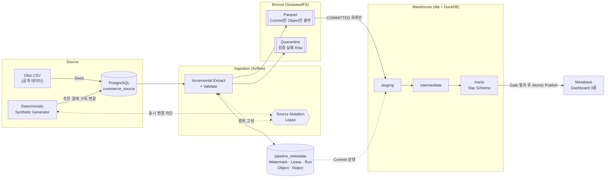
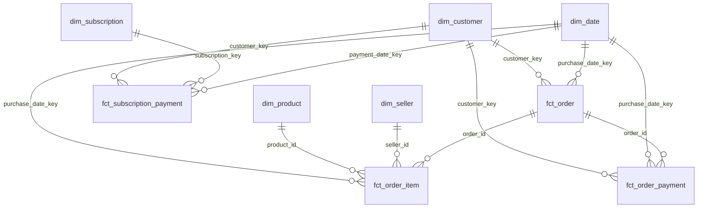

# Commerce Analytics Data Platform


> Olist 공개 데이터를 Seed로 **변경, 지연, 중복, 실패가 발생하는 OLTP Source**를 로컬에 재현하고,
> **증분 수집 → Bronze(Parquet) → dbt Star Schema → 품질 Gate → Dashboard**까지 이어지는
> 배치 파이프라인의 **신뢰성**과 **분석 모델 정합성**을 설계·검증한 프로젝트다.

기준 문서: [PRD v1.21](PRD_v1.21.md) · 단계별 기록: [`docs/phases/`](docs/phases/ROADMAP.md)

---

## 목차

1. [프로젝트 개요 및 목적](#프로젝트-개요-및-목적)
2. [기술 스택](#기술-스택)
3. [시스템 아키텍처 & 데이터 흐름](#시스템-아키텍처--데이터-흐름)
4. [데이터 모델링 (Star Schema)](#데이터-모델링-star-schema)
5. [파이프라인 구현 상세](#파이프라인-구현-상세)
6. [트러블슈팅 및 배운 점](#트러블슈팅-및-배운-점)
7. [설치 및 로컬 실행](#설치-및-로컬-실행)
8. [디렉터리 구조](#디렉터리-구조)

---

## 프로젝트 개요 및 목적

**핵심 목적**: 로컬 환경에서 배치 파이프라인을 구축하고, 스키마(Star Schema) 설계와 증분 처리, 재처리, 복구 시나리오를 검증한다.

정적 CSV를 한 번 적재하는 프로젝트가 아니다. 아래 질문에 **코드와 테스트로 답한다.**

| # | 성공 기준 | 검증 방법 |
| - | --------- | --------- |
| 1 | 동일 입력은 동일 Source 변경과 동일 Mart 상태를 만든다 | 결정적 Generator + Mart Hash 비교 |
| 2 | 실패한 Table Batch는 Watermark를 전진시키지 않는다 | Reliability R-02~R-04 |
| 3 | 같은 Batch를 반복 실행해도 중복 결과가 없다 | R-01, `delete+insert` 증분 Fact |
| 4 | 늦게 도착한 과거 이벤트가 Cursor에서 누락되지 않고 Mart에 반영된다 | R-08, R-09 |
| 5 | 주문은 **주문 발생 시점에 유효했던** 고객 Dimension Version을 참조한다 | SCD Type 2 + dbt Singular Test |
| 6 | 수집 중 Source 변경으로 Parent/Child 불일치가 생기지 않는다 | Source Mutation Lease |
| 7 | 문서의 명령만으로 새 Clone에서 재현된다 | `scripts/verify_clean_clone.sh` |

**의도적 비목표**: Kafka, Spark, Debezium CDC, Kubernetes, 클라우드 상시 운영, 실시간 SLA, 모니터링·알림 체계(핵심 범위 밖)

---

## 기술 스택

| 영역 | 기술 | 역할 |
| ---- | ---- | ---- |
| Language / Package | Python 3.12, uv (Lockfile 고정) | 수집·Generator·Publish 로직 |
| Source / Metadata | PostgreSQL 18.6 | OLTP Source(`commerce_source`), 제어 상태(`pipeline_metadata`) |
| Orchestration | Apache Airflow 3.3.1 (LocalExecutor) | Source 변경 → 수집 → 변환 → Publish DAG |
| Object Storage | SeaweedFS 4.45 (S3 호환) | Parquet Bronze, Quarantine |
| Storage Format | PyArrow / Parquet | 불변 Bronze 파일 |
| Warehouse | DuckDB 1.5.5 | 분석 Warehouse |
| Transformation | dbt-core 1.12.3 + dbt-duckdb 1.11.0 | Staging → Intermediate → Mart |
| BI | Metabase 0.63 | Sales / Product / Customer Dashboard |
| Infra | Docker Compose | 로컬 전체 Stack |
| 품질 | pytest, ruff, dbt Test | 단위·통합·Reliability 테스트 |

> Docker Image는 `latest` Tag를 쓰지 않고, Python 의존성은 `uv.lock`으로 전체 고정한다.

---

## 시스템 아키텍처 & 데이터 흐름



### 계층별 책임

| 계층 | 책임 | 하지 않는 일 |
| ---- | ---- | ------------ |
| Source DB | Olist 호환 Naming, 현재 서비스 상태, OLTP 무결성 | 분석용 Naming, 집계 |
| Ingestion | 수집 중 변경 차단, 범위 고정, 추출, 기본 검증, Bronze Commit | Mart 계산 |
| Bronze | 재처리 가능한 Source 관측 이력 | 분석용 표준화 |
| dbt + DuckDB | 표준화, 최신 상태, 이력(SCD2), Dimension/Fact | Watermark 관리 |
| Metadata DB | 제어 상태와 실행 증적 (커밋 여부의 단일 기준) | 대용량 Payload 저장 |
| Metabase | 검증 완료된 Mart 소비 | Raw Source 직접 조회 |

### Airflow DAG

- `source_simulation_dag` (`@hourly`): Generator가 Source를 변경한 뒤 `warehouse_pipeline_dag`를 Trigger
- `warehouse_pipeline_dag` (`max_active_runs=1`):

```text
initialize_run → acquire_lease → extract (Table별 mapped, 동시 3개)
                                     ├─ release_lease   (all_done)
                                     └─ verify_bronze_commit
                                              → prepare_build → dbt_build → publish_mart
                                              → export_serving_mart → repoint_metabase
```

---

## 데이터 모델링 (Star Schema)

### 왜 Star Schema인가

- **쿼리 단순화**: Fact에 Dimension을 직접 Join하는 구조라 Join 경로가 단순하고 예측 가능해, BI 쿼리를 읽기 쉽게 만든다.
- **Grain 명시**: Fact마다 "한 행이 무엇인가"를 문장으로 선언하고 Unique Key로 강제해 **Fan-out(중복 집계)** 을 차단한다.
- **이력 보존**: 고객 등급·구독 상태처럼 변하는 속성은 SCD Type 2 Dimension으로 두어 *과거 주문이 당시 속성을 기준으로 집계*된다.
- **BI 분리**: Metabase는 Mart만 읽으므로 Source 스키마 변경의 영향이 dbt 변환 계층에서 흡수된다(Mart 계약을 유지하는 한 Dashboard는 영향받지 않음).

> Grain·Unique Key·Measure 계약의 정본: [`docs/reference/mart-grain.md`](docs/reference/mart-grain.md)
> (`schema.yml`은 이 문서에서 생성). Item/Payment Raw Grain의 다대다 Join 후 `SUM`은 금지하고,
> Intermediate에서 목표 Grain으로 사전 집계한 뒤 Fact에 적재한다.



### Fact Table

| 테이블 | Grain (한 행 = ) | Unique Key | 주요 컬럼 | 비고 |
| ------ | ---------------- | ---------- | --------- | ---- |
| `fct_order` | 주문 1건 | `order_id` | `customer_key`(FK), `purchase_date_key`(FK), `order_status`, `gross_order_value`, `payment_total`, `order_count`, `delivery_days`, `delivery_delay_days`, `is_late` | 배송 Measure 포함 (주문과 Grain 동일 → 1:1 Fact 분리 안 함) |
| `fct_order_item` | 주문 상품 Line 1건 | `(order_id, order_item_id)` | `product_id`, `seller_id`, `purchase_date_key`, `item_price`, `freight_value`, `line_gross_value` | 주문 합계와 일치 Test |
| `fct_order_payment` | 주문의 결제 수단 Line 1건 | `(order_id, payment_sequence)` | `customer_key`(FK), `purchase_date_key`(FK), `payment_status`, `payment_value` | 주문 고객·구매일 FK·주문 결제 합계 검증 |
| `fct_subscription_payment` | 구독 청구 회차의 결제 시도 1건 | `payment_id` / `(subscription_id, billing_cycle_sequence, attempt_sequence)` | `subscription_key`, `customer_key`, `payment_date_key`, `payment_status`, `failure_code`, `payment_value`, `completed_payment_value`, `attempt_count` | 실패 후 재시도는 같은 회차의 다른 `attempt_sequence` |

### Dimension Table

| 테이블 | 유형 | 주요 컬럼 | 설명 |
| ------ | ---- | --------- | ---- |
| `dim_customer` | **SCD Type 2** | `customer_key`(MD5 Surrogate), `customer_id`, `membership_tier`, `attribute_hash`, `valid_from`, `valid_to`, `is_current` | 고객 거래 실적 등급 버전. 첫 버전은 `effective_from = -infinity`, 등급은 단조 비감소 |
| `dim_subscription` | **SCD Type 2** | `subscription_key`, `subscription_id`, `customer_id`, `subscription_status`, `auto_renew_enabled`, `current_period_ends_at`, `payment_failed_at`, `cancel_requested_at`, `ended_at`, `valid_from`, `valid_to`, `is_current` | 구독 계약 상태 버전. 상태 전이 유효성·겹침 없음 Test |
| `dim_product` | Type 1 | `product_id`, `category_name`, `weight_g`, `length_cm`, `height_cm`, `width_cm` | 상품 속성 |
| `dim_seller` | Type 1 | `seller_id`, `city`, `state` | 판매자 속성 |
| `dim_date` | Date Spine | `date_key`(YYYYMMDD), `calendar_date`, `year`, `quarter`, `month`, `day`, `day_of_week` | 이벤트 최소~최대 일자를 `generate_series`로 생성 |

### SCD2 설계 포인트

- Surrogate Key: `md5(business_key | valid_from | attribute_hash)`
- **미래 예정 컬럼(예: 다음 청구 예정 시각)은 Hash에서만 빼지 않고 Model에서 제거**한다. 컬럼을 남기고 Hash만 제외하면 버전 구간 동안 값이 계속 바뀌는데 첫 값만 남아 "이 구간 동안 이 값이었다"는 SCD2 계약이 깨진다. ([상세](docs/reference/mart-grain.md))

### Report Model (`marts/metrics`)

`rpt_customer_order_activity_daily` · `rpt_membership_tier_performance` · `rpt_subscription_funnel_daily` · `rpt_subscription_payment_outcomes_daily`

---

## 파이프라인 구현 상세

### 1. 수집 범위 고정과 Source 동시성 제어

- Warehouse Extract가 **Source Snapshot Lease**(수집 중 원천 변경을 막는 임대 잠금)를 보유하는 동안 Generator는 Source를 변경하지 않는다 (`src/generator/core/lease.py`, `src/ingestion/control/lease.py`).
- Lease는 Version 기반 CAS로 소유권을 검증한다. 만료·탈취 시 `LeaseOwnershipLostError`로 작업을 중단해 Parent/Child 관측 불일치를 막는다.

### 2. 멱등성(Idempotency)과 정합성

| 장치 | 설명 |
| ---- | ---- |
| **Batch Identity** | `(dag_id, logical_date)`에서 표준 Batch ID를 만들어 재실행해도 같은 Batch로 식별 |
| **Watermark CAS** | Watermark는 Metadata에서 `COMMITTED`인 Bronze 범위만 가리키며, Compare-and-Swap으로 갱신. 실패 Batch는 전진하지 않음 |
| **불변 Bronze** | Commit된 Object는 수정·덮어쓰기·삭제 금지. 재처리는 새 Object를 추가 |
| **Commit 기준 = Metadata** | dbt는 `control.bronze_files`의 `COMMITTED` Object만 **명시적 `read_parquet([...])` 목록**으로 읽음 (Prefix Glob 미사용 → 고아 Object 혼입 차단) |
| **Row Hash / Manifest** | Row Hash·Manifest로 손상·누락 검증, 이상 Row는 Quarantine으로 격리 |
| **Incremental `delete+insert`** | 영향받은 주문/결제 Key(`int_affected_*_keys`)만 교체 → 같은 Batch를 여러 번 돌려도 결과 동일 |
| **Replay Boundary**(재처리 경계) | 재처리 시 dbt Watermark/경계 Macro로 범위를 명시 (`record_replay_boundary`, `advance_processed_batch_watermark`) |
| **결정적 Generator** | 같은 Seed → 같은 변경. Commit Fence(원천 커밋 중복 방지 장치)로 중복 적용·성공 기록 유실 복구 |

### 3. 늦게 도착한 이벤트

Business Event Time은 과거일 수 있지만 Mutable Row의 `updated_at`은 **단조 증가**시켜 Cursor 기반 증분 수집이 변경을 놓치지 않는다. 늦은 주문/결제는 영향 Key 재계산으로 Mart에 반영된다. (R-08, R-09)

### 4. Publish Gate (Blue/Green식 교체)

```text
data/warehouse/build/   dbt build + test 수행
        │ 모두 통과
        ▼
data/warehouse/warehouse.duckdb   ← 검증된 파일로만 Atomic 교체
data/warehouse/failed/            ← 실패 Build는 최근 3개만 보존
```

- 발행된 Mart의 Hash를 Export 전에 다시 검증 (`src/warehouse/mart_hash.py`)
- Serving용 Export 후 Metabase 연결을 새 파일로 Repoint

### 5. 데이터 품질 테스트

- dbt Singular Test 30여 개: Grain 유일성, SCD2 구간 겹침 없음, 현재 버전 정확히 1개, 상태 전이 유효성, 주문 합계 일치 등
- `schema.yml`: `not_null`, `unique`, `relationships`, `accepted_values`
- pytest 테스트 함수 332개 (`def test_` 선언 기준, 매개변수화 확장 케이스는 별도. 단위·통합·Reliability)

### 6. Reliability Suite (R-01 ~ R-15)

장애를 **의도적으로 주입**하고 복구를 증적 JSON으로 남긴다. 시나리오별 원인·조치는 [Runbook](docs/runbooks/README.md)에 정리했다.

| 범주 | 시나리오 |
| ---- | -------- |
| 수집 Commit | 중복 Batch(R-01), 업로드 실패(R-02), Metadata 실패(R-03), Watermark CAS 충돌(R-04), Lease 만료(R-05), 고아 Object(R-06), Manifest 손상(R-07) |
| 지연·이력 | 늦은 주문(R-08), 늦은 결제(R-09), 고객 이력 변경(R-10) |
| 재처리·복구 | 스케줄 누락(R-11), Backfill Replay(R-12), 재추출(R-13), dbt 실패(R-14), Source 연결 실패(R-15) |

### 7. Benchmark (Scale S 100K · M 1M · L 5M 주문)

변수를 1개만 바꾸는 A/B 설계로 Raw 값·Median·Result Hash를 함께 기록한다. 상세: [`docs/benchmarks/`](docs/benchmarks/)

- **File Format (CSV vs Parquet)**, **Full vs Filtered Scan**, **Cold vs Warm Cache**, Extract
- 예) Filtered Scan: Row Group Pruning으로 읽은 Row가 6,000,000 → 1,000,000, M Scale Median **-22.2%** (두 Arm `result_hash` 일치)
- 병목 프로파일링으로 Row 단위 Python Tuple 변환이 소요 시간의 절반임을 실측하고 Columnar Arrow 경로로 개선

### 8. BI

Metabase 3종 Dashboard(Sales · Product · Customer)가 `Commerce Mart Serving` 하나만 조회한다. 재현 절차: [`docs/bi/dashboards.md`](docs/bi/dashboards.md)

---

## 트러블슈팅 및 배운 점

| 영역 | 문제 | 원인 | 해결 / 배운 점 |
| ---- | ---- | ---- | -------------- |
| 모델링 | Item × Payment 직접 Join 시 금액 부풀림 | 서로 다른 Grain의 다대다 Join (Fan-out) | Intermediate에서 목표 Grain으로 사전 집계 후 Join. Fact Fan-out = 0을 성공 기준으로 명문화 |
| 모델링 | SCD2 Contract 검사 122건 실패 | 주문별 계정(`customer_id`)과 사람(`customer_unique_id`)이 달라, 병행 배송지 고객을 "순서대로 바뀌는 값"인 SCD2에 넣음 | `updated_at`만 고치면 사실과 다른 이력이 조용히 생기므로, Source를 구독·등급으로 분리 ([04](docs/architecture/04-membership-table-split-comparison.md)) |
| 모델링 | SCD2 Hash에서만 제외한 미래 예정 컬럼이 낡은 값으로 남음 | 구간 동안 변하는 값이 첫 값으로 고정 | Hash 제외가 아니라 Model에서 제거 |
| 모델링 | 실행 환경에 따라 Mart Key·날짜가 하루 밀림 | dbt Profile에 TimeZone이 없어 Process TimeZone(KST/UTC)을 따름 | `TimeZone: 'UTC'` 고정을 계약에 추가, Key 식은 유지하고 `--full-refresh` 재Publish ([046](docs/architect-review/046_mart-build-session-timezone.md)) |
| 모델링 | 구독 결제 상태 대문자 전환 후 첫 증분 게시가 `accepted_values_fct_subscription_payment_payment_status__COMPLETED__FAILED`에서 실패 | 기존 Warehouse의 소문자 상태 행이 증분 빌드에 남음 | 코드 병합 후 첫 게시는 반드시 `python -m src.warehouse.publish --full-refresh`. 품질 Gate가 실패 게시를 차단해 마지막 성공본을 보존한다 ([R-14 복구 절차](docs/runbooks/r14-dbt-failure.md)) |
| 수집·적재 | 실패한 Build에서 Watermark가 전진 | dbt `on-run-end`는 Model 실패와 무관하게 실행되고, 매크로는 Fact "선택"만 확인 | `results` 상태 Guard 추가: `error`/`fail`/`skipped`가 하나라도 있으면 전진하지 않음. 다음 Build가 멱등하게 재계산 ([001](docs/architect-review/001_watermark-advance-on-failed-build.md)) |
| 수집·적재 | 수집 중 Source가 바뀌어 부모/자식 불일치 | Generator와 Extract의 동시 쓰기/읽기 | Source Mutation Lease로 상호 배제, CAS 버전으로 소유권 상실 감지 |
| 수집·적재 | 만료된 Lease 소유자가 Commit에 성공 | Commit이 Watermark CAS만 확인하고 Lease 소유자는 확인하지 않음. Generator는 Lease 확인과 Source COMMIT이 다른 커넥션이라 그 사이 인수 가능 | Commit Transaction 앞에서 Lease 행을 `FOR UPDATE`로 잠가 검사, Generator는 COMMIT 동안 `FOR SHARE`로 Fence. 2PC 없이 순서 보장 ([017](docs/architect-review/017_task7a-lease-fencing-verification.md), [055](docs/architect-review/055_generator-source-commit-lease-fence.md)) |
| 수집·적재 | Lease 해제 실패가 원래 에러를 가림 | `finally`에서 해제 예외가 원인 예외를 덮어씀 | 해제 실패를 기록하되 **원래 오류를 보존** |
| Generator | 미래 날짜 수동 실행 후 신규 주문이 조용히 유실 | Watermark가 미래로 전진해, 이후 실제 시각 행이 Watermark 아래라 `SUCCESS_NO_DATA`로 끝남 | Generator가 첫 쓰기 전에 `logical_date <= max(updated_at)`이면 Contract 위반으로 실패. 미래 날짜는 허용하고 역행만 차단 ([048](docs/architect-review/048_generator-logical-date-regression-silent-loss.md)) |
| Generator | 신규 주문이 `CREATED`에 머물러 배송 지표가 0 | 명세와 상태 전이 부품은 있었으나 정기 실행 경로에 연결되지 않음 | 정기 실행에 기존 주문 전이 단계 추가(실행당 1단계, 결제와 같은 Transaction) ([052](docs/architect-review/052_generator-orders-stuck-in-created.md)) |
| Serving·BI | Metabase가 교체 전 Serving 파일을 계속 조회 | `os.replace` 후에도 DuckDB JDBC Instance Cache와 Connection Pool이 옛 inode를 유지 | 버전 경로 Hardlink를 만든 뒤 Metabase 연결 경로를 재지정하고 `export_id`로 검증. 보존 정리는 재지정 성공 뒤로 미루고, 재지정 실패는 재시도 가능 예외로 처리 ([049](docs/architect-review/049_metabase-serving-stale-connection.md), [050](docs/architect-review/050_serving-export-retention-vs-repoint-failure.md), [051](docs/architect-review/051_metabase-repoint-retry-semantics.md)) |
| Benchmark·운영 | Publish 중 WSL 반복 멈춤, S3 HTTP 500/Timeout | Benchmark Bronze 428건(1.38억 행)이 운영 카탈로그에 섞여 운영의 약 31배를 읽음. 자원 상한 부재가 증폭 | Benchmark 전용 DB·Bucket이 없거나 운영 값과 같으면 실행 거부(fail-closed). DuckDB·Metabase·WSL 자원 상한 설정 ([조사 기록](docs/troubleshooting/2026-09-23-wsl-freeze-investigation.md)) |
| Benchmark·운영 | 벤치마크 모집단 혼합 | 크래시/무효 Run과 정상 Run을 한 범위로 기록. 승인 단계에서도 Full·Incremental 5회씩을 한 Median(143.58초)으로 합침 | 모집단이 다른 값은 합치지 않는 원칙, Cold/Warm 분리. `median_duration`에 Arm Guard, 승인 시 `runs.jsonl` 직접 확인. 정본은 Full 282.09초, Incremental 5.85초 ([037](docs/architect-review/037_phase9-task14-review-and-median-correction.md)) |
| Benchmark·운영 | 대규모 Scale에서 Extract 벤치 불가 | 원천 Row가 영구 누적되어 Scale 간 비교 무효화, 되돌릴 수 없는 쓰기 | 제외 사유와 외삽 근거를 문서화 ([05-scale-limits](docs/benchmarks/05-scale-limits.md)) |
| Benchmark·운영 | Python Row 단위 변환이 병목 | `fetchmany` Tuple 적재 | `to_arrow_reader` Columnar 순회로 교체, Hash 알고리즘은 동일 유지 |
| Benchmark·운영 | WSL2에서 Page Cache 초기화 불가 | `drop_caches` 쓰기 권한 거부 | 실패를 숨기지 않고 대체 방식을 Run Metadata에 기록 |

**배운 점**: 배치 신뢰성은 "성공 경로"가 아니라 **"어디까지 Commit됐는가를 단일 기준(Metadata)으로 정하고, 그 이전 상태를 절대 건드리지 않는 것"** 에서 나온다는 점, 그리고 모델링에서는 컬럼보다 **Grain 문장**이 먼저라는 점이다. 조용한 유실(Watermark 역행, Lease 창, 실패 Build)은 에러가 아니라 정상 종료로 드러나므로, 불변식을 코드와 Test로 고정해야 한다.

Troubleshooting 색인: [`docs/troubleshooting/`](docs/troubleshooting/README.md)

---

## 설치 및 로컬 실행

### 사전 요구사항

- Python 3.12.x, uv 0.12.9+
- Docker Desktop (WSL 사용 시 WSL Integration 활성화)

### 1. 초기화

```bash
git clone <repo-url> && cd commerce-data-platform
./scripts/init.sh          # .env 생성(기존 .env 유지), uv sync --frozen, compose 검증
```

수동 실행:

```bash
cp .env.example .env       # 예시 Secret은 실제 값으로 사용 금지
uv sync --frozen
docker compose config
```

### 2. Source 구성 (Olist Seed)

```bash
uv run python scripts/download_dataset.py
docker compose up -d postgres
uv run python -m src.seed --seeded-at 2026-09-03T00:00:00Z
```

### 3. 변경 생성 → Bronze 수집 → Warehouse Publish (수동 실행)

dbt는 Source DB가 아니라 **수집된 Bronze**를 읽으므로 Publish 전에 수집이 필요하다.

```bash
docker compose up -d --wait postgres seaweedfs
uv run python -m src.generator --seed 7 --logical-date 2026-09-04T00:00:00Z --orders 20 --initialize-metadata
uv run python -m src.ingestion --dag-id manual_run --logical-date 2026-09-04T00:00:00Z \
  --tables customers customer_subscriptions customer_membership_tiers subscription_payments \
           products sellers orders order_items order_payments
uv run python -m src.warehouse.publish --pipeline-name manual_run   # dbt build + test → 통과 시 교체
uv run python -m src.warehouse.publish --recover-only               # 중단된 Publish 복구
```

### 3-1. Airflow 자동 실행 (선택)

```bash
docker compose --profile airflow up -d      # api-server · scheduler · dag-processor
docker compose --profile bi up -d metabase  # Dashboard (Publish·Export 이후 사용)
```

Airflow UI에서 `source_simulation_dag`(`@hourly`)를 활성화하면 Generator 실행 뒤 `warehouse_pipeline_dag`가 Trigger된다.
접속 정보와 환경 변수는 `.env.example`을 참고한다.

### 4. 검증

```bash
uv run ruff check .
uv run pytest

# 새 Clone 기준 Seed → Generator → Ingestion → Publish → Integration (메인 Stack 먼저 down)
docker compose down
./scripts/verify_clean_clone.sh
```

Reliability Suite 실행법: [Runbook](docs/runbooks/README.md) · Benchmark 재현 명령: [`docs/benchmarks/00-environment.md`](docs/benchmarks/00-environment.md)

Dashboard 재생성: `uv run python scripts/metabase_snapshot.py` ([안내](docs/bi/dashboards.md))

### 5. Metabase 비밀번호 리셋

로그인 계정은 `.env`가 아니라 Metabase 첫 접속 setup에서 만든 값이며 앱 DB(`metabase_app`)에 저장된다. 비밀번호를 잊었으면 아래 순서로 리셋한다.

```bash
# 1) 관리자 이메일 확인 (모르는 경우)
docker compose exec postgres psql -U "$METABASE_DB_USER" -d "$METABASE_DB_NAME" \
  -c "select email, is_superuser from core_user;"

# 2) Metabase 중지 후 리셋 토큰 발급 (이미지 ENTRYPOINT가 인자를 가로채므로 비워야 함)
docker compose --profile bi stop metabase
docker compose --profile bi run --rm --no-deps --entrypoint "" metabase \
  java -jar /app/metabase.jar reset-password <이메일>

# 3) 재시작
docker compose --profile bi up -d metabase
```

출력된 토큰으로 `http://localhost:3000/auth/reset_password/<토큰>`에 접속해 새 비밀번호를 설정한다. 이때 DuckDB driver 로딩 에러 로그가 보여도 리셋에는 영향이 없다.

> **로컬 데이터와 Secret**: `.env`, Raw/Generated Data, DuckDB Warehouse, Airflow Log는 Git에 포함하지 않는다.

---

## 디렉터리 구조

```text
.
├── airflow/dags/        source_simulation_dag, warehouse_pipeline_dag
├── dbt/                 models(staging·intermediate·marts), macros, tests
├── sql/                 metadata·source 스키마 DDL(마이그레이션)
├── src/
│   ├── seed/            Olist CSV → PostgreSQL Seed
│   ├── generator/       결정적 Synthetic Generator, Source Lease
│   ├── ingestion/       증분 추출, Bronze Commit, Manifest, Quarantine, 재처리
│   ├── warehouse/       dbt 실행, Publish Gate, Mart Hash
│   ├── serving/         Serving Export, Metabase Repoint
│   └── benchmark/       Benchmark 실험 Harness
├── tests/               unit · integration · reliability
├── metabase/            Dashboard Query
├── scripts/             init, clean-clone 검증, 데이터 다운로드
└── docs/                phases · runbooks · troubleshooting · benchmarks · bi · reference
```
