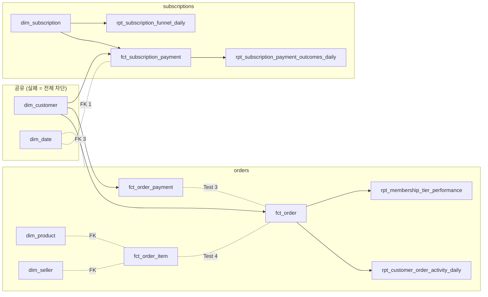

# ADR 021. Publish Gate를 도메인으로 나눈다

## Status

Accepted (2026-11-10). ADR 016·020을 보완한다. Build-then-swap 구조와 파일 1개를 통째로 교체하는 방식은 그대로다.

## Context

ADR 016의 전체 Gate는 "게시본의 모든 Table이 같은 Build에서 나온다"는 일관성을 얻기 위한 설계다. ADR 020은 그 보장 중 지표와 Fact 사이의 정합성만 내주고 지표 계층 Test를 `warn`으로 내렸다.

남은 `error` 등급 Test는 여전히 하나라도 실패하면 전체를 막는다. 그런데 Mart는 서로 참조하지 않는 두 도메인으로 나뉜다.

| 도메인 | Relation |
| ---- | ---- |
| `orders` | `fct_order`, `fct_order_item`, `fct_order_payment`, `dim_product`, `dim_seller`, `rpt_customer_order_activity_daily`, `rpt_membership_tier_performance` |
| `subscriptions` | `dim_subscription`, `fct_subscription_payment`, `rpt_subscription_funnel_daily`, `rpt_subscription_payment_outcomes_daily` |
| 공유 | `dim_customer`, `dim_date` |

두 도메인은 공유 Dimension을 통해서만 만난다. Test 148개 중 두 도메인에 걸친 것은 없다. 그런데도 구독 Test 하나가 실패하면 주문 Fact가 게시되지 못한다. 재현 실험([08](../benchmarks/08-publish-gate-domain-split.md))에서 구독 Canary 하나가 `fct_order` 5행(주문 시각 600초분)을 묶었다.

제약은 게시 방식이다. 파일 1개를 `os.replace`로 교체하므로 실패한 도메인만 "빼고" 게시할 수 없다.

## 도메인 경계 기준

도메인은 업무 용어(주문·결제·고객)로 나눈 것이 아니다. **따로 보류해도 `error` Test가 새로 깨지지 않는 가장 작은 Model 묶음**이고, dbt Manifest에서 계산한다. 보류는 "그 Model만 직전 게시 값으로 되돌리는 것"이므로 세 규칙이 따라 나온다.

| 규칙 | 내용 | 어기면 |
| ---- | ---- | ------ |
| R1 하위 닫힘 | 어떤 Model을 보류하면 그것을 `ref`하는 하위 Mart도 함께 보류한다 | 하위 Model이 실패한 상위 값으로 계산된 채 게시된다 |
| R2 Test 닫힘 | `error` Test 하나가 함께 참조하는 Model은 같은 묶음에 둔다 | 보류 자체가 Gate가 막기로 한 불일치를 만든다 |
| R3 절단 비용 | R1·R2로 묶이지 않게 하려면 연결 Model을 "공유"로 떼어 내야 하고, 공유 Model의 실패는 전체 차단이다. 떼어 내는 비용(전체 차단으로 가는 Test 수)보다 얻는 것이 클 때만 뗀다. 장애 이력이 없어 Test 개수를 대용으로 쓴 이 프로젝트의 판단이고 업계 규칙이 아니다 | 나눌수록 전체 차단이 늘어난다 |

Mart 13개를 `ref`(staging·intermediate 경유 포함)와 `error` Test 공동 참조로 이으면 **한 덩어리**다. 덩어리를 가르는 방법은 Model을 공유로 떼어 내는 것뿐이고, 후보는 넷이다(`dbt/target/manifest.json`, Canary 제외 `error` Test 134개 기준).

| 떼어 내는 Model | 갈라지는 묶음 | 전체 차단으로 가는 Test | 독립 보류를 얻는 Test | 판정 |
| ---- | ---- | ---- | ---- | ---- |
| `dim_customer` + `dim_date` | 주문 7개 Model / 구독 4개 Model | 16 | 74 (주문 41, 구독 33) | 채택 |
| `fct_order_item` | `dim_product`, `dim_seller`가 각각 분리 | 8 이상 | 4 | 기각. 손해다 |
| `dim_subscription` | `rpt_subscription_funnel_daily` 분리 | 17 | 0 (`rpt_*`는 `warn`뿐) | 기각 |
| `fct_subscription_payment` | `rpt_subscription_payment_outcomes_daily` 분리 | 15 | 0 | 기각 |

`dim_customer`·`dim_date`를 떼면 남는 연결은 정확히 두 묶음이고 그것이 `orders`·`subscriptions`다. `warn` Test를 간선에 넣어도 결과는 같다. 두 묶음은 재계산 단위와도 1:1이다(`control.affected_keys`의 `order` / `subscription_payment`). 공유 Model의 원천을 빼면 staging 원천도 겹치지 않는다.

자주 나오는 대안이 왜 도메인이 아닌지:

| 대안 | 계보 근거 | 결론 |
| ---- | ---- | ---- |
| `customers` 도메인(`dim_customer`) | 하위에 `fct_order`, `fct_order_payment`, `fct_subscription_payment`와 지표 3개가 있다(나머지 Mart 11개 중 6개, 두 묶음 모두). Fact의 `customer_key`는 이번 Build의 `dim_customer` Version에 Join해서 만든 값이다 | R1로 하위를 함께 보류하면 두 묶음 전부다. `customers` 보류 = 전체 차단이고, 그것이 지금의 "공유" 취급이다 |
| `payments` 도메인(주문 결제 + 구독 결제) | `fct_order_payment`와 `fct_subscription_payment` 사이에는 `ref`도 공동 Test도 없다. 이름만 같다 | 묶을 근거가 없다 |
| `fct_order_payment`만 분리 | `fct_order`와 `error` Test 3개로 묶인다. `stg_payments`가 `int_payment_summary`를 거쳐 `fct_order.payment_total`에도 들어간다. 재계산 Key도 주문 하나다 | R2 위반. 결제만 보류하면 `fct_order.payment_total`은 새 값, 결제 행은 옛 값이 되고 이 어긋남을 잡는 Test도 없다 |
| 주문을 주문·품목·결제 3개로 | 세 Fact가 `error` Test 7개로 서로 묶인다 | R2 위반. 보류할 때마다 7개가 경계 Test가 되고 실제로 어긋나면 전체 차단으로 물러난다 |
| `dim_product`·`dim_seller`를 `catalog` 도메인으로 | `ref` 하위가 없고 `fct_order_item`의 FK Test 1개씩으로만 묶인다. 고유 Test는 4개(전체의 3%) | 얻는 것 4개. 새 상품이 든 Batch에서 보류하면 FK가 끊겨 전체 차단으로 물러나므로 지금(주문만 보류)보다 나빠질 수 있다. 다른 묶음이 이 Dimension을 참조하게 되면 규칙대로 공유로 옮긴다 |
| 지표(`rpt_*`)를 별도 도메인으로 | `rpt_*`의 Test 13개는 전부 `warn`이다 | ADR 020의 심각도 축이 이미 처리한다 |

공유 취급의 비용: `error` Test 134개 중 독립 보류가 되는 것은 74개(55%)다. 공유 Dimension 16개(12%: `dim_customer` 12, `dim_date` 4)와 staging·intermediate 44개(33%)는 계속 전체를 막는다. 보류할 때마다 경계 Test(주문 5개, 구독 2개)를 다시 검사한다. `dim_date`는 `ref` 하위가 없지만 두 묶음의 원천으로 만들고 두 묶음의 Fact가 FK로 참조하므로 어느 한쪽에 둘 수 없다.

## Decision

1. **실패 도메인을 Build 파일 안에서 되돌린 뒤 통째로 교체한다.** `DBT_TEST_ERROR`가 한 도메인에 귀속되면 Published 파일을 읽기 전용으로 붙여 그 도메인의 Relation 전부를 한 Transaction에서 직전 게시 값으로 바꾼다. 게시 절차(`publish_build`)는 바뀌지 않는다.
2. **귀속은 dbt 산출물로 한다.** `run_results.json`의 `error`·`fail`·`skipped` Node와 `manifest.json`의 `depends_on`으로 판정한다. `skipped`가 된 staging·intermediate Node는 원인이 아니라 결과이므로 판정에서 뺀다.
3. **표에 없으면 막는다.** 공유 Dimension만 참조하는 Test, staging·intermediate Test, Model·Seed·Snapshot 오류, 두 도메인 동시 실패, Published 파일이 없는 첫 게시는 전체 차단이다.
4. **되돌린 뒤 경계 Test를 재검증한다.** 되돌린 Fact(직전 시점)와 새 공유 Dimension(최신 시점)이 한 파일에 놓인다. 보류 도메인과 공유 Dimension을 함께 참조하는 `error` 등급 Test를 다시 검사하고, 하나라도 실패하면 전체 차단으로 물러난다. `relationships`는 Manifest 정보로 SQL을 만들어 검사하고, 그 외는 dbt가 컴파일한 SQL을 실행한다.
5. **재계산 경계는 전역 1개를 유지한다.** 실패가 있는 Build는 원래 경계를 전진시키지 않는다. 다음 실행이 밀린 Key를 다시 계산하고, Key 단위 교체라 통과 도메인의 결과는 같다.
6. **부분 게시는 기록한다.** 상태는 `PUBLISHED`, `mart_publish_runs.held_domains`에 도메인 이름, Run report에 `PUBLISH_PARTIAL:<domain>`(`ok=false`), `dbt_build` 로그에 실패·경고 Node 이름을 남긴다. 되돌리기 전 Build는 `failed/`에 복사한다. `held_domains`는 `tests_warned`와 같은 이유로 전용 조회로만 읽는다([063](../architect-review/063_publish-gate-split-tests-warned-reader-compat.md)).
7. **스위치는 기본 켬이다.** DAG Param `partial_publish` 또는 CLI `--no-partial-publish`로 끄면 ADR 020까지의 동작이다.

## Alternatives

| 대안 | 기각 사유 |
| ---- | --------- |
| 도메인별 DuckDB 파일 | 공유 Dimension의 소속을 정할 수 없고 도메인 간 Join이 파일을 넘는다. Serving·Metabase가 단일 파일을 전제한다([ADR 019](019-serving-file-visibility-for-metabase.md)) |
| Snapshot Table Format(DuckLake 등) | 저장 계층 교체다. ADR 016의 전환 기준(1GB 또는 복사 60초)에 못 미친다 |
| 도메인별 dbt 2회 실행 | 공유 Dimension을 두 번 만들거나 실행 순서를 관리해야 한다. 1회 실행 결과를 귀속하면 dbt 쪽 변경이 없다 |
| 도메인별 재계산 경계 | 전역 경계와 반복 가능한 재계산으로 충분하다. 부분 게시 실행 소요는 정상 실행과 1.21초 차이였다 |
| 되돌린 뒤 `dbt test`로 재검증 | 실행 전후 Hook이 `dbt test`에서도 돌아 영향 Key 감사 기록이 다시 쌓이고, 원래 실행과 같은 var·Flag를 요구한다 |
| `dim_subscription` 실패는 전체 차단으로 두기 | 하위 Node가 건너뛰어져 귀속이 안 되는 경우였다. 구독 도메인 `error` Test의 큰 부분이 이 Model에 있어 목표를 못 이룬다. 건너뛴 Node 처리 규칙(Decision 2·4)으로 해결했다 |

## Consequences

| 구분 | 내용 |
| ---- | ---- |
| 포기 | 게시본의 모든 Table이 같은 Bronze 시점이라는 보장. 보류 도메인은 직전 게시 시점, 나머지는 최신 시점이다 |
| 유지 | 파일 단위 원자 교체. 도메인 안의 정합성(도메인 Relation은 함께 되돌린다). 공유 Dimension·staging·Model 오류의 전체 차단 |
| 보완 | 경계 Test 재검증, 귀속 불가 시 전체 차단, `held_domains`·`PUBLISH_PARTIAL` 기록, 되돌리기 전 Build 보존, 끄는 스위치. Sales·Product·Customer Dashboard 맨 위의 `도메인 게시 상태` 표(card 60)가 `serving_domain_status`의 도메인별 보류 여부·마지막 정상 게시 시각·연속 보류 횟수를 보여 준다([BI 문서](../bi/dashboards.md)) |
| 미보완 | 도메인을 가로지르는 분석(같은 고객의 주문과 구독)은 시점이 어긋난 값을 볼 수 있다. 상태 표는 어긋남을 알려 줄 뿐 없애지 않는다. 표는 지연 임계값을 판정하지 않고(판정은 Run report의 `DATA_STALE:<domain>`), 개별 카드에는 보류 표시가 없다 |
| 운영 변화 | `dbt_build` Task가 Test 실패에도 성공으로 끝난다. 감지는 Run report로 한다([R-14 Runbook](../runbooks/r14-dbt-failure.md)). 보류가 원천 주기 2회를 넘겨 이어지면 `DATA_STALE:<domain>`이 뜬다([게시 SLO](../reference/publish-slo.md)) |

게시 파일이 지키는 불변식: 통과 도메인은 이번 Build의 `error` Test를 모두 통과했고, 보류 도메인은 직전 게시 값과 같으며 경계 Test를 다시 통과했다.

알려진 한계:

- 보류된 도메인 자체는 여전히 묶인다. 실패의 범위를 좁힐 뿐이다.
- `metrics_test_severity=error`에서는 지표 Test 하나가 경계 Test에 들어가고 `fct_order` 실패 때 건너뛰어지므로 `orders` 실패가 전체 차단으로 간다. 그 값은 전체 Gate로 돌아가는 설정이라 의도와 맞는다.
- `failed/` 보존 3개를 부분 게시 증거와 전체 실패가 나눠 쓴다.
- 도메인은 2개로 고정이고 소속은 dbt `group`(`dbt/models/marts/groups.yml`, 각 `schema.yml`)에 선언한다. `group`이 없는 Mart Model의 실패는 전체 차단이다. 선언이 "도메인 경계 기준"의 계산 결과와 같은지는 `tests/test_warehouse_domain_boundary.py`가 검사한다. CI가 없어 로컬 `pytest`로만 돈다.
- staging Test 실패는 하위가 한 도메인뿐이어도 전체 차단이다. 같은 규칙(R1)을 staging까지 적용하면 18개(`stg_order_items`·`stg_payments`·`stg_products`·`stg_sellers` 11, `stg_customer_subscription_observations` 7)가 더 귀속되지만, 원천이 깨진 상태의 부분 게시라 따로 판단할 일로 남긴다.

## Validation

| 근거 | 결과 |
| ---- | ---- |
| 재현 실험 `tests/reliability/test_domain_gate_experiment.py` A | 구독 Canary 실패: 끔 `FAILED`, 묶인 주문 5행·600초 → 켬 `PUBLISHED`, `held_domains = ["subscriptions"]`, 묶인 주문 0행 |
| 같은 실험 B·E | 주문 Canary 실패: 켬 `held_domains = ["orders"]`. `dim_subscription` Canary 실패(28개 Node 건너뜀): 켬 `PUBLISHED`, 묶인 주문 0행 |
| 같은 실험 C | 의존 없는 Canary: 스위치와 무관하게 `FAILED` |
| 같은 실험 D·D-orders | 부분 게시 뒤 재실행: `held_domains = []`, 13개 Relation이 기준 파일과 모두 같음 |
| 합성 파일 단위 테스트 | 경계 Test 실패와 되돌리기 실패에서 전체 차단, `failed/`에 되돌리기 전 파일 유지 |
| R-14·기존 Canary·1단계 실험 | 수정 없이 통과 |
| `tests/test_warehouse_domain_boundary.py` | dbt `group` 선언이 R1·R2로 계산한 묶음과 같음. Model 하나를 다른 Group으로 옮긴 합성 Manifest에서는 실패 |
| 같은 실험 F (2026-11-11) | 두 도메인 Canary 동시 실패: 켬에서도 `FAILED`, `held_domains = []`, 게시본 Hash 불변 |
| 같은 실험 G (2026-11-11) | 소급 고객 관측을 주입한 실제 dbt Build: 구독 보류 뒤 경계 Test `relationships_fct_subscription_payment_customer_key` 실패 → 전체 차단, `failed/`에 되돌리기 전 파일 |
| Airflow 실행 H (2026-11-11) | 구독 Canary 강제: `dbt_build` 성공, `held_domains = ["subscriptions"]`, `PUBLISH_PARTIAL:subscriptions`, `fct_order` 99849 → 99869 |
| Run report 도메인 판정 | 구독 3회 연속 보류에서 `DATA_STALE:subscriptions`만 뜸. 보류 없이 결제 시각만 오래된 경우는 뜨지 않음 |

F·G·H의 수치와 명령은 [08 §6](../benchmarks/08-publish-gate-domain-split.md)에 있다.

검증하지 못한 것:

- `subscriptions`의 증분 복구: 이 Bronze의 마지막 Batch에 구독 변화가 없어 측정하지 못했다. 같은 경로를 `orders` 보류로 확인했다.
- 경계 Test 실패가 운영에서 저절로 생기는 경우: 정상 수집에서는 `customer_key`가 바뀌지 않는다(관측이 뒤에만 붙고 등급이 내려가지 않는다). 실험 G는 소급 관측을 주입했다. 실제로는 재적재·Backfill에서만 생길 조건이다.
- 실행 H는 Canary SQL의 var 기본값을 잠시 바꿔 만들었다. DAG에 dbt var를 넘기는 Param이 없다.
- 소요 시간은 1회 측정이다.

## 실무 관행과의 거리

| 요소 | 위치 |
| ---- | ---- |
| Build-then-swap, 심각도별 차단, 실패 하위 건너뛰기(R1) | 흔한 방식이다. R1은 [dbt `build`](https://docs.getdbt.com/reference/commands/build)가 실패한 Model의 하위를 건너뛰는 것과 같은 규칙이다 |
| 공유 Dimension의 실패는 전체 차단 | 흔한 방식이다 |
| 도메인을 dbt [`group`](https://docs.getdbt.com/docs/build/groups)과 `owner`로 선언 | dbt의 표준 수단이다. 다만 소유자가 한 명이라 소유 경계 역할은 하지 않는다 |
| 실패 도메인을 Build 파일 안에서 직전 값으로 되돌리기 | 이 프로젝트의 방식이다. 파일 1개를 통째로 교체하는 구조(ADR 016)에서 나왔다. Table 단위 Snapshot이 있는 저장 계층에서는 Table별 게시로 푼다 |
| R2·R3로 경계를 계산 | 이 프로젝트의 정식화다. 실무의 도메인은 대개 소유 조직으로 정한다 |

범위 밖으로 둔 것:

| 항목 | 이유 |
| ---- | ---- |
| CI(GitHub Actions), Slim CI | 하지 않기로 했다. 경계 단언과 테스트는 로컬 `pytest`로 돈다. 전체 Build가 수 초라 변경분만 Build할 이유도 없다 |
| 알림 | README의 의도적 비목표다. 걸 자리는 Run report의 `ok=false`다 |
| 소유 조직 기준 도메인, 다중 dbt Project | 소유자가 한 명이다 |
| Table 단위 Snapshot 게시 | ADR 016의 전환 기준(1GB 또는 복사 60초)에 못 미친다 |
| dbt `source freshness` | Bronze를 dbt Source가 아니라 Macro로 읽는다. 가장 가까운 판정은 Run report `DATA_STALE`(게시본 `fct_order`의 최신 주문 시각 기준)이고 구독 원천에는 대응 판정이 없다. `NOT_FRESH`는 Metabase가 최신 Serving 내보내기를 보는지라 다른 판정이다 |
| 오류 예산 | [게시 SLO](../reference/publish-slo.md)는 실행 단위 조건만 둔다 |
| staging 실패의 도메인 귀속 | 위 "알려진 한계"의 마지막 항목 |
