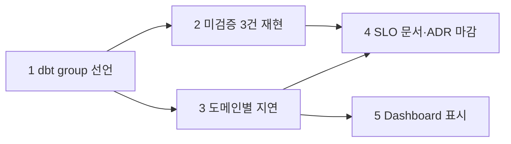

# Publish Gate 도메인 경계 근거 보강 계획

> 작성: architect, 2026-11-11 (같은 날 개정) · Branch: `feat/publish-gate-split`
> 대상: [ADR 021](../../adr/021-split-publish-gate-by-domain.md) "도메인 경계 기준" 절
> 선행: `docs/superpowers/plans/2026-11-10-publish-gate-domain-split.md`
> 커밋은 lead가 한다. backend·frontend·reviewer는 커밋하지 않는다.
> **상태: Phase 1~5 완료·커밋(2026-11-12).** Phase 1 `93f3c7a`, Phase 2 `0335c35`, Phase 3 `fac25db`, Phase 4 `c946e87`, Phase 5 `401b010`. Phase 5는 사용자 결정으로 uiux가 구현·검수했다(§4).

## 1. 결론

**현재 분리(`orders` / `subscriptions`, 공유 `dim_customer`·`dim_date`)가 계보로 계산한 최선과 같다.** 도메인 구성은 바꾸지 않는다. 바꾸는 것은 둘이다.

1. 근거: "가장 큰 독립 보류 단위"라는 설명을 규칙과 Manifest 수치로 바꿨다(ADR 021에 반영 완료).
2. 주변 구성: 1인 프로젝트지만 실무에 가깝게 보이도록 도메인을 dbt 안에서 선언하고, 부분 게시가 만든 관측 구멍을 메운다(§4).

기준 한 줄: **도메인은 따로 보류해도 `error` Test가 새로 깨지지 않는 가장 작은 Model 묶음이다.**

| 규칙 | 내용 |
| ---- | ---- |
| R1 하위 닫힘 | 보류하는 Model의 `ref` 하위 Mart는 함께 보류한다. dbt `build`가 실패 하위를 건너뛰는 것과 같은 규칙이다 |
| R2 Test 닫힘 | `error` Test 하나가 함께 참조하는 Model은 같은 묶음이다 |
| R3 절단 비용 | 묶음을 가르려면 연결 Model을 공유(실패 = 전체 차단)로 떼야 한다. 전체 차단으로 가는 Test보다 독립 보류를 얻는 Test가 많을 때만 뗀다. 장애 이력이 없어 Test 개수를 대용으로 쓴 판단이고 업계 규칙이 아니다 |

## 2. 근거 (`dbt/target/manifest.json`, Canary 제외 `error` Test 134개)

Mart 13개를 `ref`와 `error` Test 공동 참조로 이으면 한 덩어리다. 가를 수 있는 절단 후보는 넷이고 이득이 나는 것은 하나다.

| 떼어 내는 Model | 결과 | 전체 차단으로 | 독립 보류 획득 |
| ---- | ---- | ---- | ---- |
| `dim_customer` + `dim_date` | 주문 7 Model / 구독 4 Model | 16 | 74 (41 + 33) |
| `fct_order_item` | `dim_product`, `dim_seller` 분리 | 8 이상 | 4 |
| `dim_subscription` | `rpt_subscription_funnel_daily` 분리 | 17 | 0 |
| `fct_subscription_payment` | `rpt_subscription_payment_outcomes_daily` 분리 | 15 | 0 |

- **왜 `customers`가 도메인이 아닌가.** `dim_customer`의 `ref` 하위가 두 묶음 모두에 있다(나머지 Mart 11개 중 6개). R1대로 하위를 함께 보류하면 전부다.
- **왜 `payment`가 도메인이 아닌가.** 주문 결제와 구독 결제 사이에는 `ref`도 공동 Test도 없다. `fct_order_payment`는 `fct_order`와 `error` Test 3개, 공통 원천 `stg_payments`, 같은 재계산 Key로 묶인다.
- **왜 더 잘게 안 나누는가.** 주문의 세 Fact는 `error` Test 7개로 묶인다(R2). `dim_product`·`dim_seller`는 분리해도 Test 4개(3%)를 얻을 뿐이다.
- **왜 2개인가.** 계산 결과다. 재계산 단위(`affected_keys`의 `order` / `subscription_payment`)와도 1:1이다.

공유 취급의 비용: 독립 보류가 되는 Test는 74개(55%)다. 공유 Dimension 16개(12%)와 staging·intermediate 44개(33%)는 계속 전체를 막는다. 보류마다 경계 Test(주문 5, 구독 2, 전부 `relationships`)를 재검사한다.

수치 주의: Manifest는 2026-11-10 22:57 생성본이다. 이후 dbt Model 변경 Commit(23:05)이 하나 있어 Phase 1에서 다시 확인한다.

## 3. 결정 기록

**상태: 확정(2026-11-11).** 사용자가 범위 a(전 Phase, CI 제외)를 확인했다.

| 항목 | 결정 | 결정자 |
| ---- | ---- | ---- |
| 도메인 구성 | 2도메인 유지(선택지 A) | 사용자 확정 |
| 기본 CI | 하지 않는다. GitHub Actions를 만들지 않고 범위 밖으로 적는다 | 사용자 확정 |
| Phase 구성 | 아래 §4의 5개. Phase 5는 2026-11-12 사용자 결정으로 uiux가 명세·구현·검수를 담당 | 사용자 확정 |
| 도메인 선언 수단 | dbt `group` + `owner` | lead 선택 |
| 알림 | 하지 않고 이유를 적는다. **2026-11-12 변경:** 외부 채널 없이 DAG 마지막 Task의 실패로 드러낸다(`docs/superpowers/plans/2026-11-12-publish-gate-minimal-alert.md`) | lead 선택 |
| 공유 Model Contract | dbt-duckdb 1.11이 지원할 때만 Phase 1에 포함 | lead 선택 |

기각한 선택지: `catalog` 3번째 도메인(얻는 Test 4개), staging 실패의 도메인 귀속(원천이 깨진 채 게시하는 다른 성격의 결정), `meta`·`tags`로 선언(`meta`는 dbt가 뜻을 모르고 `tags`는 한 Model에 여러 개가 붙는다).

## 4. Phase

### Phase 1. dbt `group`으로 도메인 선언 (backend)

지금은 도메인 표가 `src/warehouse/domain_gate.py`의 상수(`DOMAINS`, `SHARED`)다. dbt Project만 봐서는 도메인이 보이지 않는다. 선언을 dbt로 옮기고 Python은 Manifest에서 읽는다.

**dbt 쪽**

- Group 3개를 선언한다: `orders`, `subscriptions`, `shared`. 각 Group에 `owner`(이름 또는 Email)를 적는다. 소유자는 한 명이다.
- Mart Model 13개에 `config.group`을 준다. 소속은 ADR 021의 표 그대로다. Mart Folder가 `dimensions/facts/metrics`라 Folder 단위로 줄 수 없으므로 각 `schema.yml`의 Model 항목에 적는다.
- staging·intermediate에는 Group을 주지 않는다.
- `access`는 건드리지 않는다(기본값 유지). Group을 접근 제어가 아니라 소속과 소유자 표시로 쓴다.

**Python 쪽 (`src/warehouse/domain_gate.py`)**

- `DOMAINS`·`SHARED` 상수를 지우고, Manifest의 Model `group` 값으로 같은 구조를 만든다. `attribute_failure`·`revert_domain`·`boundary_failures`가 이미 Manifest를 읽으므로 읽는 위치는 늘지 않는다.
- **Group이 없는 Mart Model이 실패에 걸리면 전체 차단이다.** 선언 누락이 "덜 막는" 쪽으로 가면 안 된다.
- `AFFECTED_KEY_DOMAIN`(Group 이름 → `affected_keys`의 도메인 값)은 Python에 남긴다. 여기에 없는 Group도 전체 차단이다.
- Mart 판별 기준(`stg_`·`int_` 접두사 제외)은 그대로다.

**기준 단언 (일반 `pytest`, CI 아님)**

- 순수 함수 하나: Manifest를 받아 Mart 사이 간선(`ref`는 staging·intermediate를 거쳐 가장 가까운 Mart까지, `error` Test는 공동 참조)을 만들고, `shared` Group을 뺀 연결 요소를 돌려준다.
- 단언: 연결 요소가 `shared`가 아닌 Group들의 Model 집합과 정확히 같다.
- 실제 Manifest로 한 번, 합성 Manifest로 "Model 하나를 다른 Group으로 옮기면 실패한다"를 한 번 확인한다.
- 재현 실험의 `_assert_manifest_matches_domain_table`은 이 함수를 쓰도록 바꾼다.

**Contract (조건부)**

- 먼저 dbt-duckdb 1.11이 Contract를 지원하는지 확인한다(`dim_date` 하나에 `contract.enforced: true`를 걸어 빌드해 본다).
- 지원하면 `dim_customer`·`dim_date`에 전 Column의 `data_type`을 선언하고 Contract를 켠다. 지원하지 않거나 incremental·SCD2와 충돌하면 넣지 않고 결과를 보고한다.

**완료조건**

1. `dbt ls --select group:orders`, `group:subscriptions`, `group:shared`의 결과가 ADR 021 표와 같다.
2. `domain_gate.py`에 Model 이름 목록이 남아 있지 않다.
3. 기준 단언이 실제 Manifest에서 통과하고, 합성 Manifest의 잘못된 소속에서 실패한다.
4. Group이 없는 Mart Model의 실패가 전체 차단이 되는 단위 테스트가 있다.
5. 기존 테스트(단위, 재현 실험 A~E, R-14)가 통과한다. 실험의 `held_domains`·Hash 결과가 이전과 같다.
6. `error` Test 분포(주문·구독·공유·staging)가 §2와 다르면 수치를 보고한다.
7. Contract: 지원 여부와 적용 결과(또는 넣지 않은 이유)를 보고한다.

**완료 (2026-11-11, backend 구현 → architect 완료조건 7/7 확인 → reviewer 리뷰 → 커밋 `93f3c7a`)**

- [x] 1. `dbt/models/marts/groups.yml`에 Group 3개(`owner.name: khangte`)를 선언하고 Mart 13개에 `config.group`을 줬다. `dbt ls --resource-type model --select group:<g>` 결과 `orders` 7, `subscriptions` 4, `shared` 2로 ADR 021 표와 같다. Test Node는 Group을 물려받지 않는다(151개 중 0개). 귀속은 Model 기준이라 영향이 없다.
- [x] 2. `domain_gate.py`에서 `DOMAINS`·`SHARED`를 지웠다. `domain_table(nodes)`가 Mart의 `config.group`으로 표를 만들고 귀속·되돌리기·경계 재검증이 이를 쓴다. Model 이름 목록은 테스트 쪽(`tests/test_warehouse_domain_gate.py`)에만 남는다.
- [x] 3. `tests/test_warehouse_domain_boundary.py`의 `mart_components`·`assert_groups_match_lineage`: 합성 Manifest에서 ref 하위·Test 상대 Model 이동, Group 누락, 공유 Model의 도메인 편입, 두 도메인 공동 `error` Test가 모두 실패한다. 실제 Manifest(`dbt parse`)에서는 통과한다. 재현 실험의 `_assert_manifest_matches_domain_table`도 이 함수를 쓴다.
- [x] 4. Group 없는 Mart의 Test 실패·건너뜀, `AFFECTED_KEY_DOMAIN`에 없는 Group(`catalog`)이 전체 차단(`None`)인 Case 3개를 추가했다. 구현 전에 3개가 실패하는 것을 확인했다.
- [x] 5. 단위 811개 통과·1개 실패(`test_doc_links`: ADR 021이 추적되지 않는 계획서에 링크, 이번 변경과 무관), 건너뜀 147개. 이 실패는 architect의 ADR 021 수정으로 해소됐고, 다시 돌린 `tests/test_doc_links.py`는 198개 모두 통과했다. 3개 Flag로 재현 실험 A~E와 R-14 2개 통과(670초). 상태·`held_domains`·`PUBLISH_PARTIAL`·D/D-orders 불일치 0은 11-10 증적과 같다. 묶인 행 수(주문 5 → 20)만 다른데, Bronze가 진행돼 경계가 11:40 → 11:50으로 옮겨졌기 때문이다. 증적: `data/reliability/gate-domain-split/20261111T085539667873Z.json`.
- [x] 6. 새로 `dbt parse`한 Manifest의 Canary 제외 `error` Test는 134개(주문 41, 구독 33, 공유 16, staging 44)로 §2와 같다.
- [x] 7. dbt-duckdb 1.11이 Contract를 지원한다. `dim_date`(7 Column)와 `dim_customer`(8 Column)에 `contract.enforced`와 `data_type`을 선언했다. 운영 Warehouse 복사본에서 두 Model이 타입 지정 DDL로 빌드되고, `date_key`를 `varchar`로 바꾸면 `data type mismatch`로 실패하는 것을 확인했다.

### Phase 2. 미검증 3건 재현 (backend)

같은 재현 실험 Harness에 Attempt를 추가한다. 새 Canary는 만들지 않는다.

| 건 | 방법 | 기대 | 완료조건 |
| ---- | ---- | ---- | ---- |
| F. 두 도메인 동시 실패 | `orders_publish_gate_canary` + `subscriptions_publish_gate_canary`를 함께 켠다 | 스위치 켬에서도 `FAILED`, `held_domains = []`, Published 파일 Hash 불변 | 실험 단언 통과, Run report 판정 기록 |
| G. 실데이터 경계 실패 | 구독 Canary로 `subscriptions`를 보류하되, 직전 게시 이후 `dim_customer` 이력이 다시 만들어져 되돌린 `fct_subscription_payment.customer_key`가 새 `dim_customer`에 없는 Bronze 조건을 만든다(`tests/reliability/faults.py`) | 경계 Test 실패 → 전체 차단, `failed/`에 되돌리기 전 파일, 오류 요약에 `partial publish fallback` | 합성 파일이 아닌 실제 dbt Build로 통과. 조건을 만들 수 없으면 왜 불가능한지(Key가 안정적인 이유)를 보고한다 |
| H. Airflow에서 `subscriptions`만 보류 | DAG를 구독 Canary var로 1회 실행한다. DAG에 dbt var를 넘길 Param이 없으므로 수동 실행 절차로 한다 | `dbt_build` Task 성공, `held_domains = ["subscriptions"]`, Run report `PUBLISH_PARTIAL:subscriptions`·`ok=false`, 주문 Fact는 최신 | Task 로그·Run report·`mart_publish_runs` 행을 증거로 첨부. var 전달 방법이 없으면 차단으로 보고한다 |

- 기존 미측정분인 실험 C·E의 Run report 판정을 같은 실행에서 기록한다.
- 공통 완료조건: `docs/benchmarks/08-publish-gate-domain-split.md`에 F·G·H 결과 행 추가.

**완료 (2026-11-11, backend 구현 → architect 완료조건 확인 → reviewer 리뷰 → 커밋 `0335c35`)**

- [x] F. 스위치를 켜도 `FAILED`/`DBT_TEST_ERROR`, `held_domains=[]`, Hash 불변이었다. Run report는 `PUBLISH_FAILED`이고 오류에 `partial publish fallback`이 없다.
- [x] G. 실제 dbt Build로 통과했다.
  - 주입: `faults.py::backdated_tier_observation`이 같은 등급 관측을 하루 앞당겨 넣는다.
  - 결과: 경계 Test `relationships_fct_subscription_payment_customer_key…` 실패 → 전체 차단. `failed/` 복사본은 되돌리기 전(옛 Key 행 0)이고, 오류는 `partial publish fallback: subscriptions: boundary tests failed`로 시작한다.
  - 대조군(Canary 없음): `PUBLISHED`
  - Key 안정성: 운영 Bronze만으로는 조건이 생기지 않는다. Cursor 수집이 추가만 하고 등급이 비감소이기 때문이며, 이 이유는 08 §6에 적었다.
- [x] H. `manual__2026-11-11T09:40:00+00:00` 결과:
  - `dbt_build` 성공, `held_domains=["subscriptions"]`, `PUBLISH_PARTIAL:subscriptions`, `ok=false`
  - `fct_order` 99849 → 99869
  - 증거: `docs/benchmarks/evidence/publish-gate-domain-boundary/02-airflow-subscriptions-held.md`
- [x] C·E Run report 판정: C는 `PUBLISH_FAILED`, E는 `PUBLISH_PARTIAL:subscriptions`
- [x] 08 §6에 C·E·F·G·H 행을 추가했다. 실험은 1개 통과(663.94초). 증적: `data/reliability/gate-domain-split/20261111T094058794989Z.json`

### Phase 3. 도메인별 지연 판정 (backend)

지금 Run report의 `data_lag_s`는 `fct_order`의 `max(purchase_at)`만 본다(`src/observability/run_report.py`). `subscriptions`가 연속으로 보류돼도 `DATA_STALE`이 뜨지 않는다. 부분 게시가 만든 구멍이다.

- 도메인마다 지연을 잰다. **기준은 그 도메인이 마지막으로 보류 없이 게시된 시각이다(architect 판정 2026-11-12, 아래).** 사건 시각 Column(`purchase_at`, `payment_at`)의 최댓값은 `domain_as_of`로 싣기만 하고 판정에 쓰지 않는다.
- 판정 `DATA_STALE:<domain>`을 추가한다. 임계값은 지금과 같은 `stale_after_s`를 쓴다.
- 기존 `DATA_STALE`·`data_lag_s`(주문 기준)는 그대로 둔다. 읽는 쪽이 깨지지 않게 추가만 한다.
- 도메인별 연속 보류 횟수를 Run report에 싣는다(`mart_publish_runs.held_domains`에서 계산).
- 도메인 목록은 Phase 1의 Group에서 온다. 기준 시각 Column 대응만 코드에 둔다.

**Serving 쪽 준비 (Phase 5 선행분)**

Dashboard(Metabase)는 Serving 파일(`Commerce Mart Serving`) 하나만 읽는다. Run report는 Postgres(`warehouse_run_reports`)에 있어 화면에서 볼 수 없다. 그래서 같은 값을 Serving 파일에 싣는다. 화면 작업 없이 backend만으로 끝난다.

- Serving Export(`src/serving/export.py`)가 `serving_manifest` 옆에 Table `serving_domain_status`를 만든다. 도메인마다 한 행이다.

  | Column | 뜻 |
  | ---- | ---- |
  | `domain` | Group 이름(`orders`, `subscriptions`) |
  | `as_of` | 그 도메인 사건 시각 Column의 최댓값. 복사된 Serving 파일에서 직접 잰다 |
  | `refreshed_at` | 그 도메인이 마지막으로 보류 없이 게시된 시각. 화면의 "기준 시각"은 이 값이다 |
  | `held` | 이번 게시에서 보류됐는지(`mart_publish_runs.held_domains`) |
  | `consecutive_holds` | 연속 보류 횟수. Run report와 같은 계산을 쓴다 |

- 기준 시각 Column 대응과 연속 보류 계산은 Run report와 같은 함수를 쓴다. 두 곳에 따로 쓰지 않는다.
- 기존 `serving_manifest`의 Column은 바꾸지 않는다. Metabase가 읽는 Schema는 추가만 된다.
- Dashboard Card는 만들지 않는다. 그것은 Phase 5다.

**완료조건**

1. `subscriptions`만 여러 번 보류한 상태에서 `DATA_STALE:subscriptions`가 뜨고 주문 쪽 판정은 뜨지 않는 테스트가 있다.
2. 연속 보류 횟수가 보류 1·2회와 복구 뒤 0으로 맞게 나오는 테스트가 있다.
3. 기존 Run report 테스트가 수정 없이 통과한다.
4. 부분 게시 뒤 Export한 Serving 파일의 `serving_domain_status`가 보류 도메인에 `held = true`와 이전 `as_of`를, 다른 도메인에 `held = false`와 최신 `as_of`를 담는 테스트가 있다. 기존 Serving 검증(`_validate_serving_file`)과 Metabase 재지정 테스트가 통과한다.
5. 구독 도메인의 Bronze 변화가 드물어 `payment_at` 기준이 평소에도 오래된 값이면, 그 사실과 대안(게시 시각 기준)을 보고한다. 판정은 architect가 한다.

**완료 (2026-11-12, backend 구현 → architect 판정(조건 5)·완료조건 1~7 확인 → reviewer 승인(지적 없음) → 커밋 `fac25db`)**

- [x] 1. `tests/observability/test_run_report_domains.py`: 구독이 3회 연속 보류되고 마지막 비보류 게시가 임계값보다 오래되면 `DATA_STALE:subscriptions`만 뜬다. `DATA_STALE`·`DATA_STALE:orders`는 뜨지 않는다.
- [x] 2. `summarize_holds` 단위 테스트(보류 1·2회 → 1·2, 복구 → 0)를 추가했다. 갱신 시각도 함께 검증한다. Postgres 사슬 통합 테스트 `test_domain_holds_follow_published_chain`(FAILED 건너뜀 포함)도 통과한다.
- [x] 3. 기존 `tests/observability/test_run_report.py`는 수정 없이 통과한다.
- [x] 4. `tests/serving/test_export_domain_status.py`: 보류 도메인은 `held=true`·이전 `as_of`, 다른 도메인은 `held=false`·최신 `as_of`다. `refreshed_at`도 검증한다. 기존 Serving 검증·Metabase 재지정 테스트도 통과한다. `test_cli.py` Fixture에는 보류 조회 대역 1줄만 더했다.
**판정 (architect, 2026-11-12): 조건 5는 대안을 채택한다.**

- 이유: 구독 결제는 9행이고 몇 주씩 비어 있다. 사건 시각 기준은 보류가 없어도 항상 `DATA_STALE:subscriptions`를 낸다. 항상 뜨는 판정은 판정이 아니다. 메우려던 구멍은 "보류가 오래 이어지는데 모른다"이고, 그것을 직접 재는 값은 마지막 비보류 게시 시각이다.
- 정의: `domain_refreshed_at[d]` = 이 Run부터 사슬을 거슬러 `d`가 `held_domains`에 없는 첫 `PUBLISHED` Run의 `finished_at`. `domain_lag_s[d]` = 지금 − 그 값. 두 도메인에 같은 정의를 쓴다.
- 찾지 못하면(사슬 한도 초과, 게시 이력 없음) `None`이고 판정하지 않는다.
- 연속 보류를 세는 사슬 조회에 `finished_at`을 더해 한 번에 구한다. 조회를 따로 만들지 않는다.
- 기존 `DATA_STALE`·`data_lag_s`(주문 사건 시각)는 그대로다.
- 추가 완료조건: (6) 보류가 없고 결제 시각이 몇 주 전이어도 `DATA_STALE:subscriptions`가 뜨지 않는 테스트. (7) Postgres 사슬 통합 테스트를 실제로 돌려 통과.
- Metabase의 새 Table 동기화는 Phase 5로 넘긴다(Metabase 미기동). → Phase 5에서 card 60이 실제 Serving의 이 Table을 조회했다(§6). `_validate_serving_file`의 허용 목록 변경은 승인한다.

- [x] 5. 보고했고 대안이 채택됐다. `domain_lag_s`는 `refreshed_at` 기준이다. `domain_as_of`는 참고값이다. 사슬 한도를 넘거나 비보류 게시가 없으면 판정하지 않는다(`test_no_clean_publish_is_not_judged`).
- [x] 6. `test_old_payment_without_hold_is_not_stale`: 보류가 없으면 결제 시각이 몇 주 전이어도 `DATA_STALE:subscriptions`가 뜨지 않는다.
- [x] 7. Postgres 통합 테스트 `tests/integration/test_publish_metadata_integration.py`를 실제로 실행했다. 20개 모두 통과한다.

### Phase 4. SLO 문서와 ADR 마감 (architect)

- 이미 코드에 있는 임계값을 게시 SLO 표로 정리한다: 지연(`stale_after_s` = 원천 주기 × 2), 실행 시간(`SLOW_RUN` 600초), 부분 게시(`PUBLISH_PARTIAL`), 연속 보류. 새 임계값을 만들지 않는다. 오류 예산은 계산하지 않는다.
- ADR 021을 갱신한다: Validation 표(Phase 1~3 결과), "검증하지 못한 것", 도메인 선언 위치(dbt Group), R3의 표현, 실무 관행 대비 위치, 범위 밖 항목(§5).
- R-14 Runbook에 `DATA_STALE:<domain>`과 연속 보류 횟수 읽는 법을 더한다.

**완료조건**: "검증하지 못한 것"과 범위 밖 항목마다 이유가 한 줄씩 있다.

**진행 (2026-11-12, architect)**: `docs/reference/publish-slo.md` 신규, ADR 021(R3 표현, Validation F·G·H·경계 단언·도메인 판정, 검증하지 못한 것, 실무 관행과의 거리, 범위 밖), R-14 Runbook(연속 보류 확인) 반영. Phase 5는 차단 그대로라 ADR "미보완"에 남겼다. 커밋 `c946e87`(PRD v1.31 포함). Phase 5 완료 뒤 ADR "미보완"은 화면 표시 반영 상태로 고쳤다(`401b010`).

### Phase 5. Dashboard 지연·보류 표시 (uiux → frontend → uiux 검수 → reviewer)

**담당 변경 (2026-11-12):** 사용자 결정으로 uiux가 명세·구현·화면 검수를 맡고, 완료 후 reviewer가 코드 리뷰한다.

**화면 명세**

- Sales·Product·Customer 세 Dashboard의 맨 위에 같은 `도메인 게시 상태` 표를 배치한다. Customer는 두 도메인을 함께 사용하고 나머지 화면에서도 데이터의 부분 게시 여부를 확인할 수 있어야 한다. 기존 필터와 연결하지 않는다.
- 데이터는 `Commerce Mart Serving`의 `serving_domain_status`만 읽는다. `orders`(주문), `subscriptions`(구독)를 각각 한 행으로 표시한다.
- 열은 `도메인`, `게시 상태`, `마지막 정상 게시 시각 (UTC)`, `마지막 사건 시각 (UTC)`, `연속 보류 횟수`다. `held=true`는 `보류`, `false`는 `정상 (보류 없음)`으로 문자 표시한다. 보류 시 이전 게시 데이터가 표시된다는 설명을 카드에 둔다. 색상만으로 상태를 구분하지 않는다.
- 시각은 `refreshed_at`(마지막 비보류 게시 시각)이며 `as_of`(마지막 사건 시각)가 아니다. 시각이 없으면 `확인 불가`로 표시하고 정상 게시 시각을 추측하지 않는다. 이 표는 임계값에 따른 지연 판정을 제공하지 않는다.
- 표의 빈 결과나 질의 오류가 정상으로 보이지 않아야 한다. 좁은 화면에서도 도메인·상태와 시각을 읽을 수 있어야 하며 필요하면 표를 가로 스크롤한다.

**완료조건**

- [x] 세 Dashboard의 첫 화면에서 상태 표가 기존 카드와 겹치지 않는다. 카드에 필터 매핑이 없고 Sales에서 날짜 필터 적용 후에도 같은 보류 상태를 확인했다.
- [x] 실제 전체 정상 Serving 내보내기 `ec871ab0-6bb6-428e-9538-a9ff18cce6c6`에서 두 도메인의 정상 상태·시각·연속 보류 0회를 응답 대체 없이 확인했다. 이전 카드 응답 대역 확인도 BI 문서에 이력으로 남겼다.
- [x] 실제 Serving에서 구독 `보류`·이전 정상 게시 시각·2회 및 주문 `정상`·0회가 일치한다. 검증용 데이터는 격리하고 실제 Serving 게시 파일을 변조하지 않았다.
- [x] 정상·보류 화면을 각각 Playwright MCP로 캡처하고 증적과 출처를 BI 문서에 기록했다. 390px 화면의 가로 스크롤, 빈 결과·HTTP 500·시각 없음 표시도 확인했다.
- [x] Metabase 카드·Dashboard Snapshot과 `docs/bi/dashboards.md`를 실제 적용 결과에 맞춰 갱신했다.
- [x] 화면 검수 후 변경 파일과 테스트 결과를 reviewer에 전달한다.

**진행 (2026-11-12):** Metabase 기동 후 최신 게시를 Serving으로 내보내 재지정했다. card 60을 세 Dashboard에 배치하고 Playwright MCP로 화면을 검수했다. 실제 보류 및 응답 대역 정상 화면의 출처는 `docs/bi/dashboards.md`에 기록했다. NULL 상태·시각·횟수의 `확인 불가`와 정상 상태는 DuckDB 임시 테이블로 카드 SQL을 실행해 확인했다. 문서 링크 테스트는 새 PNG를 임시 Git index에 넣어 실행해 202개 통과했다(실제 index에는 추가하지 않았다).

**판정 (2026-11-12, architect):** reviewer 승인(지적 없음) 후 완료조건 6개를 산출물과 대조해 충족으로 판정했다. 화면 증적은 Customer Dashboard 기준이며 Sales·Product는 Snapshot의 같은 배치(row 0, 24×4, 필터 매핑 없음)로 확인했다. ADR 021의 "미보완"·"검증하지 못한 것"을 화면 표시 반영 상태로 고쳤다.

**추가 검증 (2026-11-12):** 실제 전체 정상 Serving 내보내기 `ec871ab0-6bb6-428e-9538-a9ff18cce6c6`를 읽는 Customer Dashboard를 Playwright MCP로 응답 대체 없이 캡처했다. 주문·구독 모두 정상, 연속 보류 0회, 마지막 정상 게시 시각 `2026-11-12 02:25:47` UTC다. Sales·Product·Customer의 전체 Dashboard 캡처 스크립트도 모든 카드 완료 후 성공했다.

**추가 화면 개선 완료조건 (2026-11-12)**

- [x] Sales·Customer 필터의 적용 범위와 현재·전체 기간 기준을 제목에 표시하고, 주문 시점 등급별 서로 다른 단위의 지표를 표의 별도 열로 분리했다.
- [x] 배송 완료 상품 상위 10개를 식별 가능한 표로 표시하고 구독 전이는 사건별 막대와 읽을 수 있는 범례로 표시했다.
- [x] 상태 표에 사건 시각과 예상 도메인 누락 표시를 추가하고, 보류 없음이 전체 실행 성공이나 최신성 판정이 아님을 설명했다. 카드 43–45 및 운영 경보 카드는 사용자 범위 결정에 따라 변경하지 않았다.
- [x] 세 Dashboard와 카드 변경을 Metabase에 반영하고 실제 화면·쿼리 완료를 검증했다.

**파일·폴더별 변경 요약**

- `metabase/export/card-{40,41,42,46,47,48,49,50,51,52,53,54,55,56,57,58,59,60}.json`, `metabase/export/dashboard-{2,3,4}.json`: 카드·화면 이중 언어 제목, 필터 범위, 지표별 표, 상품 상위 10개 및 구독 전이 표시, 도메인 상태 열과 누락 처리를 반영했다.
- `docs/bi/dashboards.md`, `docs/bi/screenshots/dashboard-{2,3,4}-scope-2026-11-12.png`: 필터 범위·지표 분모·날짜 기준, 보류 사례 이력과 실제 화면 증적을 기록했다.
- `metabase/export/card-60.json`, `metabase/export/dashboard-{2,3,4}.json`: 상태 카드 SQL·문구와 세 Dashboard 배치를 저장했다.
- `docs/bi/dashboards.md`, `docs/bi/screenshots/domain-status-{held,mobile,normal-fixture}-2026-11-12.png`: 표시 의미와 검증 출처·화면 증적을 기록했다.
- `docs/bi/screenshots/domain-status-normal-real-2026-11-12.png`, `docs/bi/dashboards.md`, `docs/adr/021-split-publish-gate-by-domain.md`: 실제 전체 정상 게시 화면과 출처를 추가하고 기존 미검증 설명을 갱신했다.
- 이 계획서: 담당 변경, 화면 명세, 완료조건과 검증 이력을 기록했다.

## 5. 범위 밖 (ADR 021에 이유와 함께 적는다)

| 항목 | 이유 |
| ---- | ---- |
| CI(GitHub Actions) | 사용자 결정. 기준 단언과 테스트는 로컬 `pytest`로 돌린다 |
| Slim CI·`--defer` | CI가 없고, 전체 빌드가 수 초라 변경분만 빌드할 이유가 없다 |
| 외부 알림 채널 | README의 의도적 비목표다. 2026-11-12에 Task `domain_publish_alert`의 실패로 드러내는 최소안만 했다. 부분 게시 때 `dbt_build` Task는 성공하므로 거기에 걸면 놓친다 |
| 소유 조직 기준 도메인, 다중 Project | 소유자가 한 명이다 |
| Table 단위 Snapshot 게시 | ADR 016 기준(1GB 또는 복사 60초)에 못 미친다(현재 44.5MB) |
| dbt `source freshness` | Bronze를 dbt Source가 아니라 Macro로 읽는다. 가장 가까운 판정은 Run report `DATA_STALE`(게시본 `fct_order`의 최신 주문 시각 기준)이고 구독 원천에는 대응 판정이 없다. `NOT_FRESH`는 Metabase가 최신 Serving 내보내기를 보는지라 다른 판정이다(2026-11-12 정정) |
| 오류 예산 | SLO는 문서로 두고 예산 계산은 하지 않는다 |
| staging 실패의 도메인 귀속 | 원천이 깨진 채 부분 게시하는 결정이라 별도 ADR 감이다 |

## 6. 가정과 미검증

- `error` Canary 4개는 실험용이라 비용 계산에서 뺐다.
- Mart는 이름이 `stg_`·`int_`로 시작하지 않는 Model이다.
- PRD는 고치지 않는다는 가정이었으나 Phase 4에서 lead 결정으로 PRD v1.31에 반영했다(`c946e87`).
- 계획 시점의 미검증 항목과 확인 결과:

  | 항목 | 결과 | 확인한 곳 |
  | ---- | ---- | ---- |
  | Serving 검증(`_validate_serving_file`)이 새 Table을 허용하는지 | 허용하지 않았다. 허용 목록에 `serving_domain_status`를 더했고(architect 승인) 기존 Serving 검증·Metabase 재지정 테스트가 통과한다 | Phase 3 조건 4 |
  | Metabase가 새 Table을 읽고 메타데이터에 동기화하는지 | 읽는다. card 60이 실제 Serving의 `serving_domain_status`를 조회했다. Serving DB 2의 `sync_schema` 요청(HTTP 200) 후 metadata에서 `main.serving_domain_status`와 `domain`, `as_of`, `refreshed_at`, `held`, `consecutive_holds` 필드 5개를 확인했다. 최초 발견 시점은 확인하지 않았다 | Phase 5 |
  | 두 도메인 모두 정상인 실제 Serving 화면 | 내보내기 `ec871ab0-6bb6-428e-9538-a9ff18cce6c6`의 Customer Dashboard에서 응답 대체 없이 두 도메인 정상·연속 보류 0회를 확인했다([화면](../../bi/screenshots/domain-status-normal-real-2026-11-12.png)) | Phase 5 추가 검증 |
  | dbt-duckdb 1.11에서 `group`·Contract가 도는지 | 둘 다 돈다. `dim_date`·`dim_customer`에 Contract를 켰고 타입 불일치에서 Build가 실패한다 | Phase 1 조건 1·7 |
  | Test Node가 Model의 Group을 물려받는지 | 물려받지 않는다(151개 중 0개). 귀속이 Model 기준이라 영향이 없다 | Phase 1 조건 1 |
  | `dbt parse`만으로 기준 단언용 Manifest를 얻을 수 있는지 | 얻을 수 있다. 기준 단언은 `dbt parse` Manifest에서 통과한다 | Phase 1 조건 3 |
