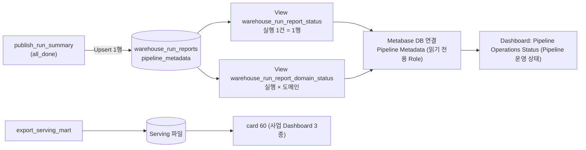

# Metabase 운영 상태 Dashboard 계획

> architect, 2026-11-12 · 설계만. 구현은 lead 승인 뒤 backend(원천)와 uiux(화면)가 한다.
> 근거: uiux Metabase 검토(2026-11-12) P1 ADD "operational status coverage", `docs/reference/publish-slo.md`, ADR 021
>
> **상태: 승인됨 (lead, 2026-11-12).** 원천은 A안으로 확정했다. 진행 순서는 §4.
> Card·Dashboard 제목은 `English (한글)` 형식으로 쓴다.

## 1. 문제

card 60 `도메인 게시 상태`는 Serving 파일의 `serving_domain_status`만 읽는다. Serving 파일은 게시와 내보내기가 성공해야 바뀐다. 그래서 아래 세 경우에 Dashboard는 정상처럼 보인다.

| 상황 | Run report 판정 | card 60이 보여 주는 것 |
| ---- | ---- | ---- |
| 전체 차단 | `PUBLISH_FAILED` | 직전 Serving 그대로. 두 도메인 "정상" |
| 내보내기·재지정 실패 | `SERVING_EXPORT_FAILED`, `REPOINT_FAILED` | 직전 Serving 그대로 |
| 행 수 급감 | `ROW_COUNT_DROP:<relation>` | 게시도 정상, 보류도 없음. "정상" |

`held = false`는 "보류되지 않았다"이지 "실행이 건강하다"가 아니다. 실행 한 건의 판정은 `pipeline_metadata.warehouse_run_reports`에만 있고 Metabase는 이 Table을 읽지 못한다.

**목표:** Metabase에서 마지막 실행의 게시 상태, 판정 코드, 지연과 임계값, 판정 시각을 본다. 게시가 실패한 실행도 보인다. 알 수 없는 것은 "정상"이 아니라 `확인 불가`로 보인다.

**범위 밖:** 외부 알림 채널, Airflow 화면 대체, 행 수 급감의 Relation별 상세 수치, 목표 비율·오류 예산, card 60의 문구 수정(검토 P2, 별도 작업).

## 2. 원천 결정 (A안 확정)

lead가 2026-11-12에 A안을 골랐다. 실패 경로를 보여 주는 안이 A뿐이다.

| 안 | 내용 | 실패 경로에서 보이나 | 비용 | 판정 |
| -- | ---- | ---- | ---- | ---- |
| **A** | Metabase에 두 번째 DB 연결을 추가한다. Postgres `pipeline_metadata`를 읽기 전용 Role로, View 2개만 보이게 한다 | 보인다. Run report는 `publish_run_summary`(`all_done`)가 쓰므로 전체 차단·내보내기 실패 실행도 한 행이 남는다 | Role 1개, View 2개, 환경 변수 2개, Metabase DB 등록 1회. PRD "Mart만 조회" 계약에 예외 문구가 필요하다(PRD v1.34) | **권장** |
| B | Run report를 Serving 파일에 싣는다(`serving_domain_status`와 같은 방식) | 안 보인다. 전체 차단·내보내기 실패 때 Serving이 안 바뀐다. 게다가 Run report는 내보내기 뒤에 써서 이번 실행의 판정은 다음 내보내기에야 실린다 | 낮음 | 기각. 문제를 못 푼다 |
| C | Run report 전용 DuckDB 파일을 따로 내보내고 Metabase에 연결한다 | 보인다 | 높음. 파일 교체·Hardlink·재지정(ADR 019)을 한 벌 더 만든다. DuckDB Instance Cache 문제도 다시 온다 | 기각 |

A안의 근거:

- Metabase는 이미 같은 Postgres에 붙어 있다(앱 DB `metabase_app`). Postgres Driver는 기본 내장이라 새 Driver가 없다.
- "Mart만 조회"는 사업 데이터를 검증 전 계층에서 읽지 않는다는 계약이다. 운영 기록은 사업 데이터가 아니다. 예외는 View 2개로 한정하고 Role 권한으로 강제한다.
- 운영 Dashboard는 사업 Dashboard 3종과 따로 둔다. 원천도 읽는 사람도 다르다.

## 3. 설계

### 3.1 접근 권한

- 새 Role `metabase_ops_ro`(환경 변수 `METABASE_OPS_DB_USER`, `METABASE_OPS_DB_PASSWORD`). `pipeline_metadata`에 `CONNECT`, `public`에 `USAGE`, 아래 View 2개에만 `SELECT`. Table 권한은 주지 않는다.
- View 소유자는 `pipeline_metadata_rw`다. Postgres View는 소유자 권한으로 읽으므로 Role은 원본 Table을 볼 수 없다.
- View는 정해진 Column만 내보낸다. `report` JSON 통째와 `tasks`, `source_lease_owner`, 파일 크기류는 내보내지 않는다.
- Metabase 포트는 지금처럼 `127.0.0.1`에만 묶인다. 공개 공유는 꺼져 있다(`MB_ENABLE_PUBLIC_SHARING=false`).
- Role 생성은 `sql/bootstrap/01-create-databases-and-roles.sh`에 넣는다. 이 Script는 새 Volume에서만 돈다. 기존 Volume용 1회 명령을 `metabase/README.md`에 적는다.

### 3.2 View

`sql/metadata/007_create_warehouse_run_report_views.sql`(`CREATE OR REPLACE VIEW`, 멱등). `record_run_report`가 006 다음에 적용한다. Role이 있을 때만 `GRANT`한다.

**`warehouse_run_report_status`** — 실행 1건에 1행

| Column | 출처 | 비고 |
| ---- | ---- | ---- |
| `dag_run_id`, `logical_date`, `recorded_at`, `ok` | Table Column | |
| `publish_status`, `publish_error_type`, `serving_export_status`, `metabase_repoint_status` | `report` | |
| `fresh` | `report->'fresh'` | Metabase 환경 변수가 없으면 NULL |
| `failure_codes` | `failures`를 `, `로 이은 text | 빈 배열이면 빈 문자열이 아니라 NULL |
| `alert_codes` | `failures` 중 `PUBLISH_PARTIAL:`·`DATA_STALE:`·`PUBLISH_FAILED`·`ROW_COUNT_DROP:`로 시작하는 것 | `ALERT_FAILURE_PREFIXES`와 같아야 한다(§3.5) |
| `held_domains` | `report` | text |
| `data_lag_s`, `stale_after_s`, `dag_elapsed_s`, `tests_warned`, `full_refresh` | `report` | 숫자·Boolean으로 변환. 없으면 NULL |
| `record_age_s` | `now() - recorded_at` | **조회 시각 기준. 이 View에서 유일한 실시간 값** |
| `status` | 아래 규칙 | |

`status`는 위에서부터 먼저 맞는 것 하나다.

| 순서 | 조건 | 값 | 뜻 |
| ---- | ---- | ---- | ---- |
| 1 | `stale_after_s`가 NULL이거나 `record_age_s > stale_after_s` | `확인 불가` | 최근 실행 기록이 없다. 아래 값은 지난 실행의 것이다 |
| 2 | `alert_codes`가 있음 | `알림 대상` | `domain_publish_alert`가 실패한 실행 |
| 3 | `ok = false` | `판정 있음` | 기록만 남는 판정(`SLOW_RUN`, `DBT_TEST_WARN` 등) |
| 4 | 그 밖 | `정상` | |

**`warehouse_run_report_domain_status`** — 실행 × 도메인

`dag_run_id`, `recorded_at`, `domain`, `lag_s`(`domain_lag_s`), `refreshed_at`(`domain_refreshed_at`), `as_of`(`domain_as_of`), `consecutive_holds`, `held`(`held_domains`에 들어 있음), `stale_after_s`. 도메인 목록은 `domain_lag_s`의 Key에서 얻는다. 도메인 값이 없는 실행(Build 전 실패, 2026-11-12 이전 기록)은 행이 없다.

### 3.3 Dashboard와 Card

Dashboard `Pipeline Operations Status (Pipeline 운영 상태)`(사업 Dashboard와 분리). 제목은 아래 표대로 `English (한글)` 형식으로 쓴다. 배치·본문 문구·표시 형식은 uiux가 명세한다. 아래는 담아야 할 내용과 뜻이다. 기존 Card 40~60과 Dashboard 2~4의 제목은 이 작업에서 바꾸지 않는다.

| Card | 원천 | 내용 |
| ---- | ---- | ---- |
| `Last Run (마지막 실행)` | `warehouse_run_report_status`의 최신 `recorded_at` 1행 | `status`, 실행 ID, 논리 시각, 판정 기록 시각(UTC), 기록 후 경과, 게시·내보내기·재지정 상태, Dashboard 최신 여부(`fresh`) |
| `Verdict Codes (판정 코드)` | 같은 행 | `failure_codes` 전체와 `alert_codes`. 없으면 `판정 없음` |
| `Lag vs Threshold (지연과 임계값)` | 같은 행 + 도메인 View | 주문 데이터 지연(`data_lag_s`), 도메인별 갱신 지연(`lag_s`), 임계값(`stale_after_s`), 연속 보류 횟수 |
| `Recent Runs (최근 실행 이력)` | `warehouse_run_report_status` 최근 20건 | 기록 시각, `status`를 뺀 판정(`ok`, 게시 상태, 판정 코드, 알림 대상 여부), 실행 시간 |

- **실행 ID Filter**(선택, 기본값은 최신 실행). 지난 실패 실행을 같은 Card로 다시 볼 수 있다. 화면 검수도 이 Filter로 실제 기록을 쓴다(§4 Phase 3).
- **판정 시각**: `domain_publish_alert`는 기록 직후에 도는 Task이고 자기 시각을 따로 남기지 않는다. `recorded_at`을 판정 시각으로 쓰고 화면 이름도 "판정 기록 시각"으로 한다. "알림 발송 시각"이라고 쓰지 않는다. 외부 알림은 없다.
- **이력 Card에는 `status`를 쓰지 않는다.** `status`의 1번 규칙은 조회 시각 기준이라 지난 행은 전부 `확인 불가`가 된다.

### 3.4 확인 불가 상태

| 경우 | 화면 |
| ---- | ---- |
| Table이 비어 있음 | `Last Run (마지막 실행)` Card가 행 없이 비지 않고 `기록 없음` 한 행을 보인다(Card SQL이 고정 한 행에 `LEFT JOIN`) |
| 최근 기록이 임계값보다 오래됨 (Scheduler 정지, `publish_run_summary` 실패, `RUN_REPORT_WRITE_FAILED`) | `status = 확인 불가`. 지난 실행의 값은 그대로 보이되 "지난 실행"임을 표시 |
| 실행이 진행 중 | 직전에 끝난 실행을 보인다. Card 이름을 "마지막으로 끝난 실행"의 뜻으로 쓴다 |
| 개별 값이 NULL (`fresh`, `data_lag_s`, 도메인 값, Probe 실패) | 그 칸만 `확인 불가`. 0이나 `정상`으로 바꾸지 않는다 |
| Postgres 정지 | Metabase 자체가 뜨지 않는다(앱 DB가 같은 Postgres). 이 Dashboard로는 알 수 없다. 문서에 적는다 |

상시 운영이 아니라서 시연 때는 대부분 `확인 불가`로 시작한다. 이것이 맞는 표시다. 마지막 실행 뒤에 무슨 일이 있었는지 모르기 때문이다. card 60에 조회 시각 판정을 넣지 않은 것과 다른 점은, 여기서는 "지연"이라는 실패 판정이 아니라 "모름"이라는 중립 상태로 보인다는 것이다.

### 3.5 Snapshot과 실시간

| 값 | 기준 시각 |
| ---- | ---- |
| 지연(`data_lag_s`, `lag_s`), 임계값, 판정 코드, 게시 상태 | 그 실행의 `recorded_at`에 잰 값. 조회할 때 다시 계산하지 않는다 |
| `record_age_s`, `status`의 1번 규칙 | 조회 시각 |
| card 60(`serving_domain_status`) | 마지막으로 성공한 내보내기 시점. 실패 실행은 반영되지 않는다 |

- 화면에 "지연은 판정 기록 시각 기준"이라는 범위 표시를 둔다.
- 두 화면이 어긋날 수 있다. 전체 차단 뒤 card 60은 정상, 운영 Dashboard는 `알림 대상`이다. 이때 옳은 쪽은 운영 Dashboard다. `docs/bi/dashboards.md`에 적는다.
- Metabase Card Cache는 이 Dashboard에서 끈다(기본값 유지 확인).
- `alert_codes`의 접두사는 View SQL과 `ALERT_FAILURE_PREFIXES` 두 곳에 있다. 단위 테스트 하나가 SQL 파일에 네 접두사가 모두 있고 그 밖의 `LIKE` 접두사가 없음을 검사한다.

## 4. Phase

진행 순서는 아래와 같다. 앞 Phase의 완료조건이 충족돼야 다음으로 간다.

### Phase 1. 계약 문서 (architect)

구현보다 먼저 계약을 고친다. backend와 uiux는 이 문서를 기준으로 구현한다.

- ADR 022 신규: 운영 기록을 Metabase의 두 번째 원천으로 둔다(§2의 세 안과 A안을 고른 이유).
- PRD v1.34(v1.33은 `PRD.bak/`으로 옮긴다): "Mart만 조회" 계약의 예외, Role `metabase_ops_ro`, View 2개.

완료조건:

1. `docs/adr/022-*.md`가 있고 세 안, 결정, 한계(§3.4의 Postgres 정지, 기록 저장 실패)를 적는다.
2. `PRD_v1.34.md`가 있고 `PRD_v1.33.md`는 `PRD.bak/`에 있다. 저장소의 `PRD_v1.33` 참조가 모두 v1.34를 가리킨다.
3. PRD의 예외 문구가 View 2개와 읽기 전용 Role로 한정된다. 사업 Dashboard 3종의 "Mart만 조회"는 그대로다.
4. `tests/test_doc_links.py` 통과.

### Phase 2. 원천 (backend)

- `sql/metadata/007_create_warehouse_run_report_views.sql`, `record_run_report`에서 적용.
- Role 생성(`sql/bootstrap/01-create-databases-and-roles.sh`), `.env.example`, `compose.yaml`의 Postgres 환경 변수.
- `scripts/metabase_import.py`는 Card가 쓰는 DB마다 Serving 최신 여부를 검사한다(94~103행). Postgres 연결 Card에서는 이 검사를 건너뛰어야 한다. `scripts/metabase_snapshot.py`의 수집 대상 Collection에 새 Dashboard가 들어가는지도 확인한다.

완료조건:

1. Postgres 통합 테스트: `metabase_ops_ro`로 View 2개를 읽을 수 있고 `warehouse_run_reports`·`mart_publish_runs`는 권한 오류가 난다.
2. 통합 테스트: 판정이 다른 기록 4건(정상, `PUBLISH_FAILED`, `ROW_COUNT_DROP:<relation>`만, `SLOW_RUN`만)에서 `alert_codes`와 `status`가 §3.2 표와 같다. `recorded_at`이 오래된 행은 `확인 불가`다.
3. 통합 테스트: 도메인 값이 없는 기록은 도메인 View에 행이 없고 오류도 없다.
4. 단위 테스트: View SQL의 접두사가 `ALERT_FAILURE_PREFIXES`와 같다.
5. 기존 Run report 테스트와 Metabase 가져오기 테스트가 통과한다. `uv run pytest`, Ruff 통과.
6. `record_run_report`의 실패 처리(저장 실패는 로그만)가 그대로다. View 적용 실패가 DAG를 실패시키지 않는다.

### Phase 3. 화면 (uiux 명세 → uiux 구현 → uiux 검수)

- Metabase DB 연결 `Pipeline Metadata` 등록(Role `metabase_ops_ro`), Card 4개, Dashboard 1개, `metabase/export/` Snapshot.

완료조건:

1. 네 Card가 §3.3의 내용을 담고 View 2개만 읽는다. Card와 Dashboard 제목이 §3.3의 `English (한글)` 제목과 같다.
2. 실행 ID Filter로 실제 기록 3건의 화면 증적이 있다: 정상 실행, 부분 게시 실행(`PUBLISH_PARTIAL:<domain>`), 전체 차단 실행(`PUBLISH_FAILED`). 세 종류 모두 기존 이력 28건 안에 있다.
3. `확인 불가`(오래된 기록)와 `기록 없음`(빈 Table), NULL 칸의 화면 증적이 있다. 실제 기록으로 만들 수 없는 것은 대체 방법을 증적에 적는다.
4. `ROW_COUNT_DROP`은 이력에 없다. Card SQL을 임시 데이터로 실행한 결과로 대신하고 그렇게 적는다.
5. 화면에 UTC 표시, "판정 기록 시각 기준" 범위 표시, card 60과의 차이 안내가 있다.
6. Metabase 관리 화면에서 새 연결에 View 2개만 보인다.

### Phase 4. 리뷰 (reviewer)

Phase 2 코드와 Phase 3 Snapshot. Phase 2 코드는 Phase 3을 시작하기 전에 먼저 리뷰받아도 된다.

### Phase 5. 화면 문서 (architect)

화면이 있어야 쓸 수 있는 문서다. `docs/reference/publish-slo.md`, `docs/bi/dashboards.md`, `docs/bi/evidence.md`, `metabase/README.md`(기존 Volume용 Role 추가 명령 포함), `docs/phases/phase-10-bi.md`, README BI 절.

완료조건:

1. 위 문서가 Dashboard 이름, Card 4개, 원천 View, `확인 불가`의 뜻, card 60과 어긋날 때 어느 쪽이 옳은지를 적는다.
2. `docs/bi/evidence.md`가 Phase 3의 화면 증적을 가리킨다.
3. `tests/test_doc_links.py` 통과.

## 5. 가정과 확인하지 않은 것

- 가정: 운영 Dashboard는 사업 Dashboard와 같은 Metabase 계정으로 본다. 계정·Group별 권한 분리는 하지 않는다(사용자가 한 명이다).
- 가정: `확인 불가`의 임계값은 새 값을 만들지 않고 그 실행의 `stale_after_s`(원천 주기 2배)를 쓴다.
- 확인하지 않음: Metabase v0.63이 Postgres View를 Table처럼 동기화하는지. 일반적으로 되지만 이 환경에서 돌려 보지 않았다. Phase 3 첫 단계에서 확인한다. 안 되면 Card를 Native SQL로만 쓰면 된다.
- 확인하지 않음: `scripts/metabase_snapshot.py`·`metabase_import.py`가 DB 연결이 둘인 Snapshot을 다른 환경에서 되살릴 때 DB ID를 어떻게 맞추는지. Card 60은 `database: 2`가 고정돼 있다. 새 연결의 ID는 환경마다 다를 수 있다.
- 확인하지 않음: 기존 Volume에서 Role을 추가하는 1회 명령.
- 이력의 `stale_after_s`는 실행마다 다를 수 있다(최근 기록은 1,200초). View는 행마다 자기 값을 쓴다.
