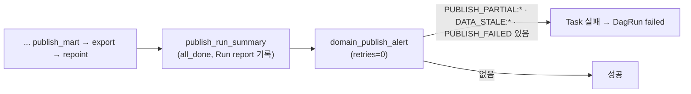

# Publish Gate 최소 알림 계획

> 작성: architect, 2026-11-12 · Branch: `feat/publish-gate-split`
> 선행: `docs/superpowers/plans/2026-11-11-publish-gate-domain-boundary.md`, [ADR 021](../../adr/021-split-publish-gate-by-domain.md)
> 커밋은 lead가 한다. backend·reviewer는 커밋하지 않는다.
> 상태: Phase 1·2 완료(2026-11-12), 커밋 대기. lead가 2026-11-12에 "알림 안 함" 선택을 뒤집고 최소안을 승인했다. 같은 날 §5의 두 항목도 확정됐다(PRD v1.32, `PUBLISH_FAILED` 포함).

## 1. 목표

부분 게시, 도메인 지연, 전체 차단이 Airflow 화면에서 빨갛게 보이게 한다.

지금은 한 도메인이 보류돼도 `dbt_build`가 성공으로 끝나고 DagRun도 `success`다. 위반은 `warehouse_run_reports`를 직접 조회해야 보인다. 이 구멍은 ADR 021이 만들었다. 전체 차단도 `dbt_build`만 빨갛고 DagRun은 `success`다(Leaf인 `publish_run_summary`가 `all_done`으로 성공한다).

## 2. 범위

| 한다 | 하지 않는다 |
| ---- | ---- |
| DAG 마지막에 Task 하나를 더한다. Run report 판정에 `PUBLISH_PARTIAL:<domain>`, `DATA_STALE:<domain>`, `PUBLISH_FAILED`가 있으면 실패한다 | Slack·메일·호출 같은 외부 채널 |
| 실패 메시지에 판정 코드를 그대로 싣는다 | 새 임계값, 새 판정 코드 |
| README 비목표 문구와 관련 문서를 고치고 PRD를 v1.32로 올린다 | 나머지 `ok=false` 판정(`DBT_TEST_WARN`, `NOT_FRESH`, `SLOW_RUN` 등)에서의 실패 |
| | 주문 사건 시각 기준 `DATA_STALE`(콜론 없는 것)에서의 실패 |
| | Run report 판정·기록 방식 변경 |

## 3. 설계



1. **판정 선택은 순수 함수 하나다.** `src/observability/run_report.py`에 둔다.

   ```python
   ALERT_FAILURE_PREFIXES = ("PUBLISH_PARTIAL:", "DATA_STALE:", "PUBLISH_FAILED")

   def alert_failures(failures: list[str]) -> list[str]:
       """Task 실패로 드러낼 판정만 고른다."""
       return [code for code in failures if code.startswith(ALERT_FAILURE_PREFIXES)]
   ```

   `DATA_STALE:`는 콜론이 있어 `DATA_STALE`(주문 사건 시각)은 걸리지 않는다. `PUBLISH_FAILED`는 게시 상태가 `FAILED`일 때의 판정 코드다. `PUBLISH_SKIPPED`·`PUBLISH_UNKNOWN`은 넣지 않는다(Build 이전에 실패한 Task가 이미 빨갛다).

2. **`publish_run_summary`는 반환값에 Key 하나만 더한다.** `return {**summary, "run_report_failures": report["failures"]}`. `collect_run_report`에 넘기는 `summary`와 기록되는 Run report는 그대로다. Task는 지금처럼 성공으로 끝난다.

3. **새 Task `domain_publish_alert`를 `publish_run_summary` 뒤에 둔다.** `retries=0`, `trigger_rule`은 기본값이다. `alert_failures(summary["run_report_failures"])`가 비어 있지 않으면 `AirflowFailException("DOMAIN_PUBLISH_ALERT: <코드들>")`을 던진다.

설계 근거:

| 선택 | 이유 |
| ---- | ---- |
| `publish_run_summary` 안에서 던지지 않고 Task를 따로 둔다 | Run report는 자기 Task 상태를 읽는다(`_probe_tasks`). 따로 두면 기록이 끝난 뒤에 실패하므로 Report 내용이 바뀌지 않고, 요약 Task의 성공·XCom을 읽는 기존 증거·테스트가 그대로다 |
| `ok=false` 전체가 아니라 세 접두사만 | 나머지 판정은 이미 실패한 Task가 있거나(`SERVING_EXPORT_FAILED`) 경고 성격이다(`DBT_TEST_WARN`). 전부 걸면 거의 매번 빨갛고, 항상 뜨는 신호는 신호가 아니다 |
| `PUBLISH_FAILED`를 넣는다 | 넣지 않으면 부분 게시는 DagRun `failed`, 전체 차단은 `success`가 된다. 더 가벼운 실패가 더 빨갛게 보인다 |
| `retries=0` | 같은 XCom을 다시 읽을 뿐이라 재시도해도 결과가 같다. DAG 기본값은 2회다 |
| XCom으로 넘긴다 | Postgres를 다시 조회하지 않는다. 판정 코드 목록은 작다 |

바뀌는 동작:

- 부분 게시 실행과 전체 차단 실행의 DagRun 상태가 `success`에서 `failed`로 바뀐다. DagRun 상태는 Leaf Task가 정하고 Leaf가 이 Task가 된다.
- 게시 자체는 영향이 없다. 이 Task는 게시·Serving 내보내기·Metabase 재지정이 모두 끝난 뒤에 돈다.
- 다음 실행도 영향이 없다. `source_simulation_dag`의 Trigger는 `wait_for_completion=False`이고 `depends_on_past`를 쓰지 않는다.

## 4. Phase

### Phase 1. 판정 선택과 DAG Task (backend → reviewer)

변경 파일:

- `src/observability/run_report.py`: `ALERT_FAILURE_PREFIXES`, `alert_failures`.
- `airflow/dags/warehouse_pipeline_dag.py`: `publish_run_summary` 반환값, 새 Task와 연결.
- `tests/observability/test_run_report_alert.py`(신규), `tests/test_airflow_dags.py`.

**완료조건**

1. `alert_failures` 단위 테스트가 있다. `PUBLISH_PARTIAL:subscriptions`, `DATA_STALE:orders`, `PUBLISH_FAILED`는 고르고, `DATA_STALE`·`DBT_TEST_WARN`·`PUBLISH_SKIPPED`·`SERVING_EXPORT_FAILED`는 고르지 않는다. 빈 목록은 빈 목록이다.
2. DAG 구조 테스트가 있다. `domain_publish_alert`가 `publish_run_summary`의 바로 아래이고 DAG의 유일한 Leaf이며 `retries`가 0이다.
3. Task 함수 테스트가 있다. `run_report_failures`에 `PUBLISH_PARTIAL:subscriptions`가 있을 때와 `PUBLISH_FAILED`가 있을 때 각각 `AirflowFailException`이 나고 메시지에 그 코드가 있다. `["DBT_TEST_WARN"]`과 `[]`에서는 예외가 없다. 호출 방식은 기존 `test_repoint_task_fails_when_repoint_result_is_failed`를 따른다.
4. `tests/observability/test_run_report_domains.py`는 수정 없이 통과한다. `tests/observability/test_run_report.py`는 `test_summary_keeps_xcom_and_emits_json` 하나만 고친다(아래 판정). 나머지 테스트는 수정 없이 통과한다.
5. Marker 없는 `pytest` 전체와 `ruff check`가 통과한다. `tests/test_airflow_dags.py`의 기존 테스트를 고쳐야 하면 고친 테스트와 이유를 보고한다.
6. `publish_run_summary`의 반환값을 읽는 곳이 새 Task 말고 없음을 `rg`로 확인하고 결과를 보고한다.

**완료 (2026-11-12, backend 구현 → reviewer 승인(지적 없음) → architect 완료조건 대조)**

- [x] 1. `tests/observability/test_run_report_alert.py`: 세 코드는 고르고 `DATA_STALE`·`DBT_TEST_WARN`·`PUBLISH_SKIPPED`·`SERVING_EXPORT_FAILED`는 고르지 않는다. 빈 목록과 순서 유지도 검증한다.
- [x] 2. `test_domain_publish_alert_is_sole_leaf_below_summary_without_retries`: Decorator가 `task_id="domain_publish_alert"`, `retries=0`이고, `summary`의 하위는 이 Task뿐이며 이 Task의 결과는 어디에도 연결되지 않는다. DAG 파일의 AST로 검사한다.
- [x] 3. `test_domain_publish_alert_fails_on_alert_codes`(`PUBLISH_PARTIAL:subscriptions`, `PUBLISH_FAILED`), `test_domain_publish_alert_passes_without_alert_codes`(`["DBT_TEST_WARN"]`, `[]`).
- [x] 4. `test_run_report.py`는 `test_summary_keeps_xcom_and_emits_json`만 바뀌었고 공용 Fixture `healthy`는 그대로다. `test_run_report_domains.py`는 변경이 없다.
- [x] 5. reviewer가 따로 돌렸다: `uv run pytest -q` 853 통과·148 건너뜀, `uv run ruff check .`와 `git diff --check` 통과. 기존 DAG 테스트는 고치지 않았다.
- [x] 6. `publish_run_summary` 반환값을 실행 중에 읽는 곳은 새 Task뿐이다(reviewer 확인).

변경 파일: `src/observability/run_report.py`, `airflow/dags/warehouse_pipeline_dag.py`, `tests/observability/test_run_report_alert.py`, `tests/observability/test_run_report.py`, `tests/test_airflow_dags.py`.

**판정 (architect, 2026-11-12): 설계 이탈 승인. 대안 A.**

- 사유: 완료조건 4의 "수정 없이"가 §3.2와 충돌했다. `test_summary_keeps_xcom_and_emits_json`이 반환 Dict 전체를 단언하고, 대역 Report에 `failures`가 없다. 반환값에 Key를 더하는 것이 의도한 변경이므로 그 단언을 고치는 것이 맞다. 계획을 쓸 때 이 테스트를 확인하지 않았다.
- 고칠 범위는 그 테스트 하나다. 기대 Dict에 `run_report_failures: []`를 더한다. 대역 Report는 공용 Fixture `healthy`를 고치지 않고 이 테스트 안에서 `{**healthy, 'failures': []}`로 만든다.
- `collector.assert_called_once_with('settings', result, ...)`는 그대로 두면 실패한다(`result`에 새 Key가 있다). `run_report_failures`를 뺀 Dict와 비교하도록 고친다. 이 단언이 "Run report에 넘기는 요약은 그대로"를 지킨다.
- 대안 B(`ti.xcom_push`)는 기각한다. XCom 경로가 둘이 되고 테스트도 고쳐야 한다.

### Phase 2. 문서 (architect, Phase 1 승인 뒤)

| 파일 | 고칠 내용 |
| ---- | ---- |
| `README.md` 49행 | 비목표를 "모니터링·알림 체계(핵심 범위 밖)"에서 **"외부 알림 채널(Slack·메일·호출)과 모니터링 스택(핵심 범위 밖)"**으로 바꾼다 |
| `README.md` 243행 | 끝에 "부분 게시와 도메인 지연은 DAG 마지막 Task `domain_publish_alert`의 실패로 드러난다"를 더한다 |
| `docs/runbooks/r14-dbt-failure.md` "도메인 부분 게시" 절 | "Task 실패 알림으로는 보이지 않으므로"를 고친다. `dbt_build`는 성공이고 `domain_publish_alert`가 실패한다. 이 실패는 게시가 안 됐다는 뜻이 아니다 |
| `docs/reference/publish-slo.md` "하지 않는 것" | 알림 항목을 실제 동작으로 고친다. 어떤 판정이 Task 실패로 가는지 절을 따로 두어 적는다 |
| `docs/adr/021-split-publish-gate-by-domain.md` | "운영 변화"와 "범위 밖"의 알림 행을 고친다 |
| `docs/superpowers/plans/2026-11-11-publish-gate-domain-boundary.md` §3·§5 | 알림 결정이 2026-11-12에 바뀌었음을 적고 이 계획을 가리킨다 |
| `PRD_v1.31.md` → `PRD_v1.32.md` | `PRD_v1.31.md`를 `PRD.bak/`로 옮기고 `PRD_v1.32.md`를 쓴다. 1587행 부근 DAG Task 목록에 `domain_publish_alert`를 `publish_run_summary` 아래에 더하고 변경 이력에 한 줄을 적는다. `README.md`, `docs/reference/data-transformation-flow.md`의 `PRD_v1.31` 참조를 v1.32로 고친다 |
| `docs/benchmarks/evidence/publish-gate-domain-split/03-*.md` | 고치지 않는다. 당시 실행 기록이다(전체 차단에서 DagRun `success`) |

**완료조건**

1. 위 표의 파일마다 고친 문장이 Phase 1의 실제 Task 이름·동작과 같다.
2. `rg "알림" README.md docs/adr/021-* docs/reference/publish-slo.md docs/runbooks/r14-*`의 결과에 "알림을 보내지 않는다"·"Task 실패 알림으로는 보이지 않는다" 뜻의 문장이 남지 않는다.
3. `PRD_v1.31.md`가 `PRD.bak/`에 있고 루트에는 `PRD_v1.32.md`만 있다. `rg "PRD_v1.31"`이 `PRD.bak/`와 과거 계획서 밖에서 나오지 않는다.
4. `pytest tests/test_doc_links.py`가 통과한다.

**완료 (2026-11-12, architect)**

- [x] 1. 표의 파일을 실제 Task 이름 `domain_publish_alert`, 메시지 `DOMAIN_PUBLISH_ALERT: <판정 코드>`, 세 판정에 맞춰 고쳤다. `publish-slo.md`에는 "Task 실패로 드러나는 판정" 절을 더했다.
- [x] 2. 네 문서에 "알림을 보내지 않는다"·"Task 실패 알림으로는 보이지 않는다"는 문장이 남지 않았다. 남은 "알림"은 외부 채널을 하지 않는다는 문장이다.
- [x] 3. `PRD_v1.31.md`를 `PRD.bak/`로 옮기고 `PRD_v1.32.md`를 썼다(§0 변경 요약, §13.2 Task 목록, §17 부분 게시 문장). `README.md`, `data-transformation-flow.md`의 참조를 v1.32로 고쳤다.
- [x] 4. `tests/test_doc_links.py`는 새 PRD를 임시 Git index에 넣어 돌렸다. 실제 index에는 넣지 않았다. 결과는 lead 보고에 있다.

## 5. 결정 기록 (lead, 2026-11-12)

| 항목 | 결정 | 반영한 곳 |
| ---- | ---- | ---- |
| PRD | v1.32로 올려 DAG Task 목록에 새 Task를 더한다. 기존본은 `PRD.bak/`로 옮긴다 | Phase 2 |
| 전체 차단 때의 DagRun 상태 | 접두사에 `PUBLISH_FAILED`를 더해 전체 차단도 `failed`로 맞춘다 | §3, Phase 1 완료조건 1·3 |

## 6. 가정과 미검증

- `DATA_STALE:<domain>`은 게시 시각 기준이다. 전체 차단이 오래 이어지면 두 도메인 모두 뜬다. 그때는 `PUBLISH_FAILED`로 이미 실패한다.
- 전체 차단 실행에서 `publish_run_summary`가 읽는 게시 상태가 `FAILED`라는 것은 증거 03의 기록과 `judge_run_report`의 코드(`PUBLISH_<status>`)로 판단했다. 실제 실행으로 다시 확인하지 않았다.
- 실제 Airflow에서 부분 게시를 일으켜 빨간 Task를 확인하는 실행은 완료조건에 넣지 않았다. 실험 H처럼 Canary의 var 기본값을 잠시 바꿔야 해서다. DAG 테스트로 대신한다.
- Marker `airflow`·`reliability` 테스트 중 부분 게시나 전체 차단 뒤 DagRun `success`를 기대하는 것이 있는지는 확인하지 않았다. `tests`·`scripts`에서 DagRun 상태를 단언하는 코드는 검색에 나오지 않았다.
- `docs/phases/`의 과거 Phase 문서에 있는 Task 목록은 당시 기록이라 고치지 않는다.
